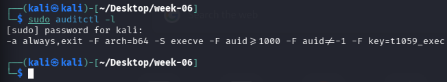
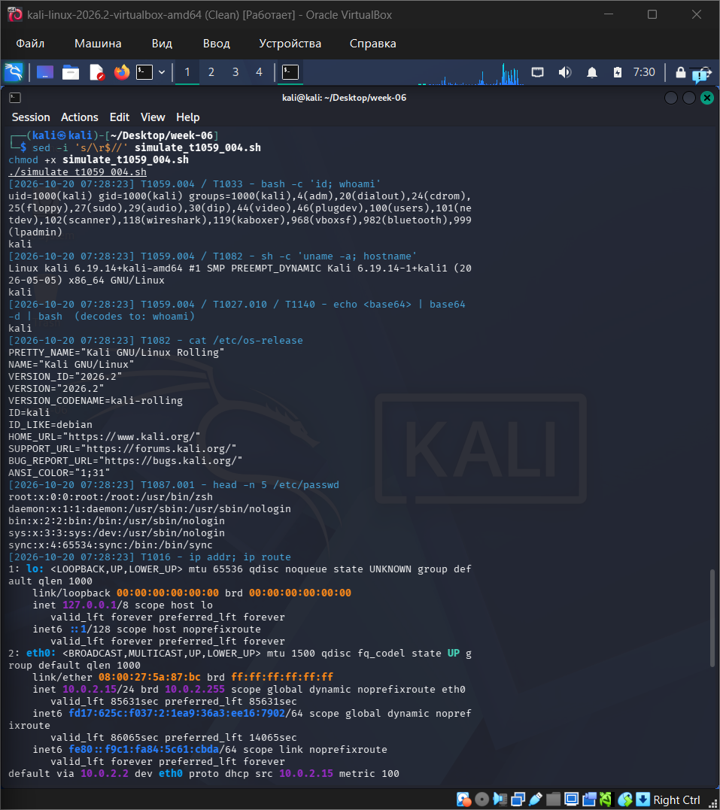
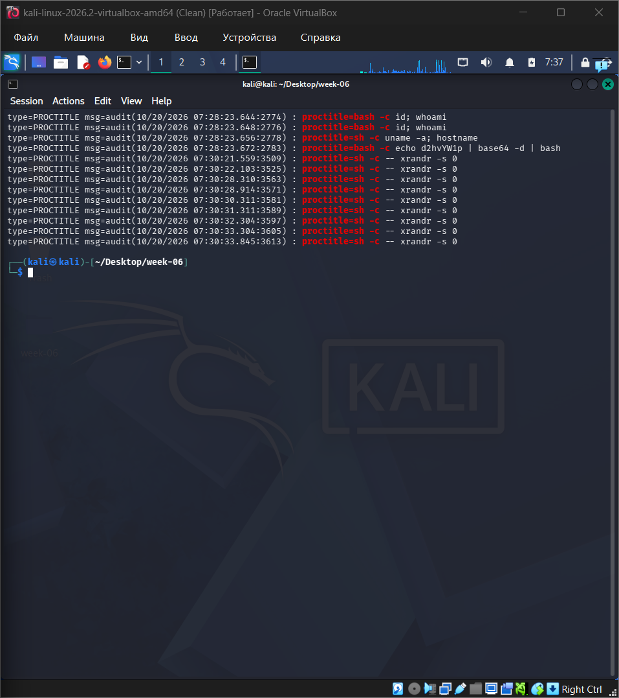
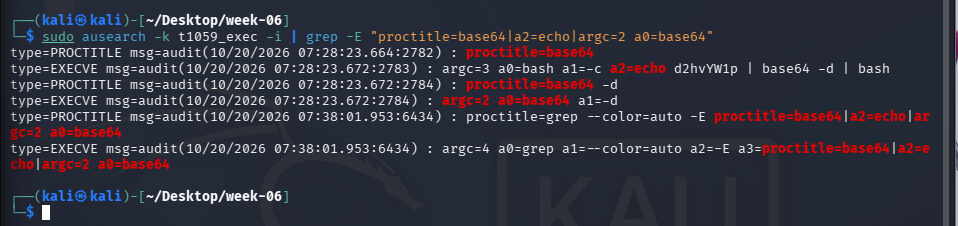
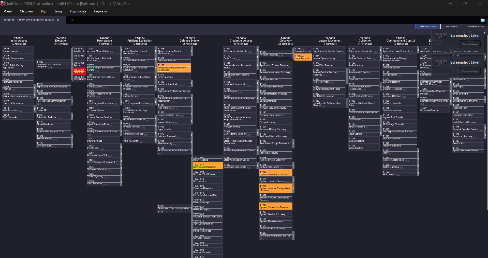

# Week 06: MITRE ATT&CK Framework (Tactics, Techniques, Procedures)

**Project:** threat-hunting-project1
**Technique studied:** T1059 - Command and Scripting Interpreter (focus: **T1059.004 Unix Shell**)
**Author:** Muptiadil Ikhsan
**Group / topic:** CS-2417
**Date:** 2026-10-20

---

## 1. Objective

1. Understand the ATT&CK structure: **Tactics, Techniques, Procedures (TTPs)**.
2. Study one technique in depth (T1059.004 Unix Shell).
3. Simulate the technique safely in a Kali Linux lab and observe the telemetry it creates.
4. Map the results to ATT&CK tactics and techniques and visualise them in **ATT&CK Navigator**.
5. Turn the result into a detection (Sigma rule) that feeds our threat-hunting project (Week 7).

Source: https://attack.mitre.org

---

## 2. Background

### 2.1 Tactics, Techniques, Procedures

| Term | Meaning | Example from this report |
|---|---|---|
| **Tactic** | The attacker's *goal* (the "why") | Execution (TA0002) |
| **Technique** | *How* the goal is achieved (the "how") | T1059 Command and Scripting Interpreter |
| **Sub-technique** | A more specific version of a technique | T1059.004 Unix Shell |
| **Procedure** | The exact way a real group or tool uses it | A script running `echo <Base64> \| base64 -d \| bash` to hide a command |

### 2.2 Why T1059.004?
- It belongs to the **Execution** tactic, and shells are the most basic way to run commands on Linux and macOS.
- Bash and sh are installed on practically every Linux system, so attackers can "live off the land" without bringing extra tools.
- Because the shell is a legitimate program, detection depends on **command-line and behaviour analysis**, which is what threat hunting does.

### 2.3 T1059 sub-techniques (Enterprise)
| ID | Name |
|---|---|
| T1059.001 | PowerShell |
| T1059.002 | AppleScript |
| T1059.003 | Windows Command Shell |
| T1059.004 | Unix Shell |
| T1059.005 | Visual Basic |
| T1059.006 | Python |
| T1059.007 | JavaScript |
| T1059.008 | Network Device CLI |


---

## 3. Lab Setup

| Item | Value |
|---|---|
| Environment | Kali Linux in a VirtualBox virtual machine |
| Version | Kali Linux 2026.2 (kernel 6.19) |
| Network | NAT (VM address 10.0.2.15) |
| Snapshot taken before test | Yes (snapshot named "Clean") |
| Logging used | auditd (execve rule) |

### 3.1 Install and enable auditd (in Kali)

```bash
sudo apt update
sudo apt install -y auditd
sudo systemctl enable --now auditd

# Log every program execution by normal users, tagged with the key t1059_exec
sudo auditctl -a always,exit -F arch=b64 -S execve -F "auid>=1000" -F "auid!=4294967295" -k t1059_exec

# Check the rule is active
sudo auditctl -l
```

**Screenshot 1:** auditd running and rule active



---

## 4. Simulation

> Safety: the script only runs harmless commands (`id`, `uname`, `cat /etc/os-release`, `ip addr`, etc.). It downloads nothing, changes nothing, and installs nothing. It was run only in my own lab.

Script: [`simulate_t1059_004.sh`](simulate_t1059_004.sh)

### 4.1 How to run
```bash
chmod +x simulate_t1059_004.sh
./simulate_t1059_004.sh
```

### 4.2 Simulated attack chain

| Step | Command | What it represents | Technique | Tactic |
|---|---|---|---|---|
| 1 | `bash -c 'id; whoami'` | Attacker checks which account they run as | T1059.004, T1033 | Execution, Discovery |
| 2 | `sh -c 'uname -a; hostname'` | Attacker checks the system | T1059.004, T1082 | Execution, Discovery |
| 3 | `echo <Base64> \| base64 -d \| bash` | Attacker hides the command in Base64 | T1059.004, T1027.010, T1140 | Execution, Defense Evasion (Stealth in v20) |
| 4 | `cat /etc/os-release` | Learn OS version | T1082 | Discovery |
| 5 | `head -n 5 /etc/passwd` | List local accounts | T1087.001 | Discovery |
| 6 | `ip addr; ip route` | Learn network configuration | T1016 | Discovery |

**Screenshot 2:** script running


---

## 5. Results

### 5.1 Reading the audit log

```bash
# All recorded executions with the key we set
sudo ausearch -k t1059_exec -i | tail -n 60

# Only the encoded command
sudo ausearch -k t1059_exec -i | grep -i base64
```

In each event, note:
- `proctitle=` shows the **full command line**
- `exe=` shows the program (for example `/usr/bin/bash`)
- `ppid` / `pid` show the parent and child process
- `auid` shows which user started it

**Screenshot 3:** audit event for `bash -c 'id; whoami'`


**Screenshot 4:** audit event showing `base64 -d | bash`


### 5.2 Evidence summary

| Step | Evidence in auditd | Key field |
|---|---|---|
| 1 | execve of `/usr/bin/bash`, then `id`, `whoami` | proctitle contains `bash -c id; whoami` |
| 2 | execve of `/usr/bin/sh`, then `uname`, `hostname` | proctitle contains `sh -c uname -a; hostname` |
| 3 | execve of `bash` with `echo ... \| base64 -d \| bash`, then `base64`, `bash`, `whoami` | proctitle contains `base64 -d` |
| 4 to 6 | execve of `cat`, `head`, `ip` | child processes of the script's shell |

### 5.3 Fallback evidence (if auditd is not available)
- The script's own timestamped log: `simulation_log.txt`
- Shell history: `history | tail -n 30`
- Process listing taken while running: `ps -ef --forest`

This is weaker evidence because an attacker could erase shell history, which is why central logging such as auditd is preferred.

### 5.4 Observations
- All six simulated steps ran within about one second (timestamps 07:28:23 in the script log). This speed is typical of automated command execution and is hard to produce by typing manually.
- The Base64 trick hid the command inside the script, but auditd still recorded the full command line, including `echo d2hvYW1p | base64 -d | bash`. The string `d2hvYW1p` decodes to `whoami`, so a defender can recover the real command from the log.
- The audit log contains a lot of unrelated noise, for example repeated `sh -c -- xrandr -s 0` entries from the desktop and the `sudo`, `ausearch`, and `grep` commands I ran while investigating. Auditd records every process, so hunting needs filters, such as searching for `base64 -d` or for shell `-c` commands.
- The rule had to be in place before the simulation. Without auditd or similar logging, this activity would leave little trace beyond shell history, which an attacker could delete.

---

## 6. Mapping to ATT&CK

| Tactic | Technique ID | Technique | Evidence |
|---|---|---|---|
| Execution | T1059.004 | Command and Scripting Interpreter: Unix Shell | Steps 1, 2, 3 |
| Defense Evasion (Stealth in v20) | T1027.010 | Obfuscated Files or Information: Command Obfuscation | Step 3 |
| Defense Evasion (Stealth in v20) | T1140 | Deobfuscate/Decode Files or Information | Step 3 |
| Discovery | T1033 | System Owner/User Discovery | Step 1 |
| Discovery | T1082 | System Information Discovery | Steps 2, 4 |
| Discovery | T1087.001 | Account Discovery: Local Account | Step 5 |
| Discovery | T1016 | System Network Configuration Discovery | Step 6 |

> **Note on ATT&CK versions:** The Navigator screenshot below was made with an older ATT&CK version in which the tactic is called **Defense Evasion (TA0005)**. In ATT&CK v20 (offered by Navigator's upgrade workflow) this tactic was split into **Stealth (TA0005)** and **Defense Impairment (TA0112)**, and the Base64 techniques (T1027.010, T1140) appear under Stealth. The technique IDs stay the same; only the tactic name differs between versions.

### 6.1 ATT&CK Navigator
1. Open https://mitre-attack.github.io/attack-navigator/
2. **Open Existing Layer → Upload from local** and choose [`navigator-layer.json`](navigator-layer.json).
3. Take a screenshot. Red = main technique studied, orange = supporting techniques observed.

If Navigator shows a version warning, change `"attack": "17"` in the JSON to the version shown on the Navigator page.

**Screenshot 5:** Navigator layer


---

## 7. Detection

### 7.1 Sigma rule: Base64 decoded and piped into a shell

```yaml
title: Base64 Decoded Command Piped Into Shell
id: 7b3e9c14-2d5a-4f8b-b6a1-3c4d5e6f7a8b
status: experimental
description: Detects a command line that decodes Base64 and pipes the result into a shell, a common way to hide commands (T1059.004, T1027.010, T1140).
author: Muptiadil Ikhsan
date: 2026/10/19
tags:
    - attack.execution
    - attack.t1059.004
    - attack.defense-evasion
    - attack.t1027.010
    - attack.t1140
logsource:
    category: process_creation
    product: linux
detection:
    selection:
        CommandLine|contains:
            - 'base64 -d | bash'
            - 'base64 -d | sh'
            - 'base64 --decode | bash'
            - 'base64 --decode | sh'
    condition: selection
falsepositives:
    - Admin or installer scripts that decode embedded data into a shell
level: medium
```

### 7.2 Quick hunting idea
```bash
sudo ausearch -k t1059_exec -i | grep -iE "base64 (-d|--decode)"
```

### 7.3 Hunting hypothesis (links to our project)
> "If an adversary has gained a shell on a Linux host, they will run discovery commands (id, uname, /etc/passwd, ip addr) in quick succession, sometimes hiding commands with Base64. We should see several discovery commands from one parent shell in a short time, or `base64 -d` piped into a shell."

---

## 8. Mitigations

| Mitigation | ID | How it helps against T1059.004 |
|---|---|---|
| Execution Prevention | M1038 | Limit which programs and scripts can run (for example AppArmor / SELinux profiles) |
| Disable or Remove Feature or Program | M1042 | Give service accounts `/usr/sbin/nologin` instead of a real shell; remove unneeded shells |
| Privileged Account Management | M1026 | Limit sudo and root access so a stolen account can do less |

Also: send audit logs to a central system (SIEM) so evidence cannot be erased locally.


---

## 9. Limitations
- The simulation is a **simplified lab exercise**, not a real intrusion. Real attackers use more tools and hide better.
- Results depend on what logging was enabled.
- The Sigma rule matches one specific pattern and will miss other ways of hiding commands. It can also have false positives and would need tuning.

---

## 11. References
- MITRE ATT&CK: https://attack.mitre.org
- T1059 Command and Scripting Interpreter: https://attack.mitre.org/techniques/T1059/
- T1059.004 Unix Shell: https://attack.mitre.org/techniques/T1059/004/
- MITRE ATT&CK Navigator: https://mitre-attack.github.io/attack-navigator/
- Sigma rules: https://github.com/SigmaHQ/sigma
- Atomic Red Team (optional, for more tests): https://github.com/redcanaryco/atomic-red-team
