# Week 07: Using MITRE CAR (Cyber Analytics Repository)

**Group topic:** phishing campaigns impersonating Kazakhstani brands (Kaspi, eGov, Kazpost, CDEK)
**Syllabus tasks (3.3, week 7):** (1) select an analytic model from CAR and implement it in a SIEM; (2) map the analytic to related ATT&CK techniques.
**Topics:** analytics vs detections. **Sources:** car.mitre.org, MITRE CAR documentation.
**Performed by:** Kazhymukan Boris · **Date:** 2026-10-20 · Week 6 (ATT&CK, T1059.004) was done by Muptiadil Ikhsan.

**Deliverables**

| File | What it is |
|---|---|
| this `README.md` | report |
| [`scripts/generate_w7_logs.py`](scripts/generate_w7_logs.py) | builds one week of lab Sysmon logs with 5 planted phishing executions |
| [`scripts/car_analytic.py`](scripts/car_analytic.py) | the CAR analytic in plain Python, three versions, scored against ground truth ([`data/car_results.txt`](data/car_results.txt)) |
| [`queries/car_2014_04_003_elk.esql`](queries/car_2014_04_003_elk.esql) | Elastic (Kibana ES\|QL) implementation, blocks Q0 … V2-chain |
| [`queries/car_2014_04_003.spl`](queries/car_2014_04_003.spl) | the same in Splunk SPL |
| [`rules/kibana_rule_w7_powershell.json`](rules/kibana_rule_w7_powershell.json) | the analytic as a **Kibana Security detection rule** (ES\|QL rule, ATT&CK mapping included) |
| [`rules/kibana_rule_w7_car_as_published.json`](rules/kibana_rule_w7_car_as_published.json) | CAR taken literally, as a second rule, to compare alert volume |
| [`rules/kibana_rule_w7_brand_dns.json`](rules/kibana_rule_w7_brand_dns.json) | **our topic rule**: Kazakhstani brand look-alike domain resolved by a non-browser process |
| [`sigma-rules/rule-004-powershell-non-interactive-parent.yml`](sigma-rules/rule-004-powershell-non-interactive-parent.yml) | portable Sigma version (validated with pySigma) |
| [`navigator-layer-w7.json`](navigator-layer-w7.json) | ATT&CK Navigator layer: what the analytic covers |

## How to reproduce

```bash
cd week-07
python3 scripts/generate_w7_logs.py     # data/sysmon_w7.csv (845 events) + data/ground_truth.csv
python3 scripts/car_analytic.py         # expected results + charts in images/
# then load data/sysmon_w7.csv into Elastic (section 5) and run queries/car_2014_04_003_elk.esql
```

---

## 1. Analytics vs detections

| | CAR **analytic** | SIEM **detection** |
|---|---|---|
| What it is | A documented detection *idea*: hypothesis, required data, pseudocode | A rule that runs on schedule in one SIEM and creates alerts |
| Written for | Any environment (abstract data model: `process/create/exe`) | One environment: real index, field names, allow-lists |
| Tuned? | No, it knows nothing about our software | Yes, tuned on our own logs and false positives |
| Example here | CAR-2014-04-003 pseudocode (section 3) | `rules/kibana_rule_w7_powershell.json` (section 6) |
| Lifecycle | Research → published in CAR | Implemented → tested → tuned → monitored |

In short: **CAR tells us *what* to look for and *which data* we need; turning it into a detection is our job.** This week shows that gap in numbers: the analytic as published produced 211 alerts for 3 real attacks; the tuned detection produced 5 alerts for 5 attacks (section 7).

CAR and Sigma are related but not the same. Sigma is a *rule format* (a detection waiting for a backend), while a CAR entry also carries the hypothesis, the data model, ATT&CK coverage ratings, D3FEND mapping and test data.

## 2. Choosing the analytic

Week 6 studied T1059 (Command and Scripting Interpreter). On the CAR "analytics by technique" page, T1059 has these analytics:

| CAR ID | Title | Sub-technique | Fits our topic? |
|---|---|---|---|
| **CAR-2014-04-003** | **PowerShell Execution** | T1059.001 | **Yes**: a phishing attachment that runs PowerShell is the core of our kill chain (week 4) and hunt H3 (week 5) |
| CAR-2014-11-004 | Remote PowerShell Sessions | T1059.001 | No: lateral movement, not phishing |
| CAR-2013-02-003 | Processes Spawning cmd.exe | T1059.003 | Partly (macro → cmd) |
| CAR-2014-11-002 | Outlier Parents of Cmd | T1059.003 | Partly, used as a complement (scenario M2) |
| CAR-2013-04-002 | Quick execution of a series of suspicious commands | T1059.005 | No |
| CAR-2021-01-002 | Unusually Long Command Line Strings | T1059 | Possible next step (encoded payloads are long) |

CAR has **no analytic for T1059.004 Unix Shell**, the Linux sub-technique simulated in week 6. That is why we moved to the Windows sub-technique T1059.001, which is also what our phishing scenario uses: Kazpost, Kaspi and eGov lures delivered to Windows workstations.

## 3. CAR-2014-04-003 "PowerShell Execution"

| Field | Value (car.mitre.org) |
|---|---|
| ID / submitted | CAR-2014-04-003, 2014-04-11, MITRE |
| Type / platform | TTP analytic, Windows, host / process data |
| Hypothesis | PowerShell that is **not** started from the interactive shell (`explorer.exe`) may be malicious |
| ATT&CK coverage | T1059.001 under Execution (TA0002): **High**; under Defense Evasion (TA0005): **Moderate** |
| D3FEND | D3-PSA Process Spawn Analysis |
| Data model | `process` / `create` / `exe`, `parent_exe` |
| Implementations given | pseudocode, Splunk (Sysmon EID 1), EQL, DNIF, LogPoint |
| True positive in CAR | Mordor dataset: `powershell.exe -nop -sta -w 1 -enc …` with parent `wmiprvse.exe` |

Pseudocode from CAR:

```
process = search Process:Create
powershell = filter process where (exe == "powershell.exe" AND parent_exe != "explorer.exe")
output powershell
```

**Data needed and where we get it.** `Process:Create` with `exe` and `parent_exe` = Sysmon Event ID 1 (`Image`, `ParentImage`). In our lab CSV the columns are `image` and `parent_image` (plus `original_file_name`, which Sysmon also logs).

## 4. Test data

Same fictitious company as week 5 (QazLogistics LLP, 24 Windows workstations), next week **2026-10-12 … 2026-10-18**. `generate_w7_logs.py` is seeded, so every run produces identical files. Ground truth is kept in a separate file, so the SIEM data has no labels, like real logs.

**Benign activity (the noise CAR will have to live with)**

| ID | Activity | Parent → child | Events |
|---|---|---|---|
| B1 | Nightly IT inventory (scheduled task) | svchost.exe → powershell.exe | 168 |
| B2 | ManageEngine UEMS agent, encoded commands | dcagentservice.exe → powershell.exe | 30 |
| B3 | Users open Outlook | explorer.exe → OUTLOOK.EXE | 120 |
| B4 | it.admin opens PowerShell by hand | explorer.exe → powershell.exe | 15 |
| B5 | Developer o.li, VS Code terminal | Code.exe → powershell.exe | 10 |

**Planted phishing executions** (lab-safe: each `-enc` payload is Base64 of a plain-text placeholder; 203.0.113.0/24 is a documentation range)

| ID | Lure | Host / user | Chain | Why it is interesting |
|---|---|---|---|---|
| M1 | Kazpost parcel notice `.docm` | WS-021 e.sultanov | OUTLOOK → WINWORD → powershell -enc | Classic; also caught by week-5 rule-003 |
| M2 | Kaspi statement `.xlsm` | WS-008 m.tulegenov | OUTLOOK → EXCEL → **cmd.exe** → powershell -enc | Parent is cmd, rule-003 misses it |
| M3 | eGov notice `.hta` | WS-014 t.zhaksylykov | OUTLOOK → **mshta.exe** → powershell -w hidden -enc | System binary proxy (T1218.005) |
| M4 | CDEK waybill `.lnk` in a ZIP | WS-003 d.omarov | **explorer.exe** → powershell -WindowStyle Hidden -enc | A double-clicked shortcut makes explorer the parent: **CAR blind spot** |
| M5 | Kaspi bonus `.js` | WS-017 z.temirova | wscript.exe → **winupdate.exe** (renamed powershell) | `exe == powershell.exe` fails: **CAR blind spot** |

Each payload then **resolves a brand look-alike domain** (Sysmon EID 22) and connects to it (EID 3, 203.0.113.x:443):

| Attack | Domain | Where the domain comes from |
|---|---|---|
| M1 Kazpost | `kazpost-delivery-track.net` | week-3 MISP event (known IoC) |
| M2 Kaspi | `kaspi-bonus-2026.com` | week-3 MISP event (known IoC) |
| M3 eGov | `eg0v-portal.kz` | week-3 MISP event (known IoC) |
| M4 CDEK | `cdek-nakladnaya.top` | **new**, in no feed |
| M5 Kaspi | `kaspi-cashback.online` | **new**, in no feed |

Background DNS (487 EID 22 events in total) includes official brand sites from browsers (`kaspi.kz`, `egov.kz`, `post.kz`, `cdek.kz` …), the **benign look-alike `cdekteam.ru`** that our week-2 OSINT already marked as a false positive, and one user (WS-005) who **clicked the Kazpost link** in Chrome but did not open the attachment.

## 5. SIEM setup (Elastic, Docker)

We used the same Elastic stack as in week 5 (Docker on a MacBook M2, see `../week-05/SETUP.md`, Option B):

1. `curl -fsSL https://elastic.co/start-local | sh`, open `http://localhost:5601`, log in as `elastic`.
2. Kibana → **Upload a file** → `data/sysmon_w7.csv` → index name **`th-w7-sysmon`**, time field **`time`** → Import.
3. **Discover → ES|QL**, time picker 2026-10-12 … 2026-10-19, run block **Q0**: expected `event_id 1 = 353`, `event_id 3 = 5`, `event_id 22 = 487`.

<!-- 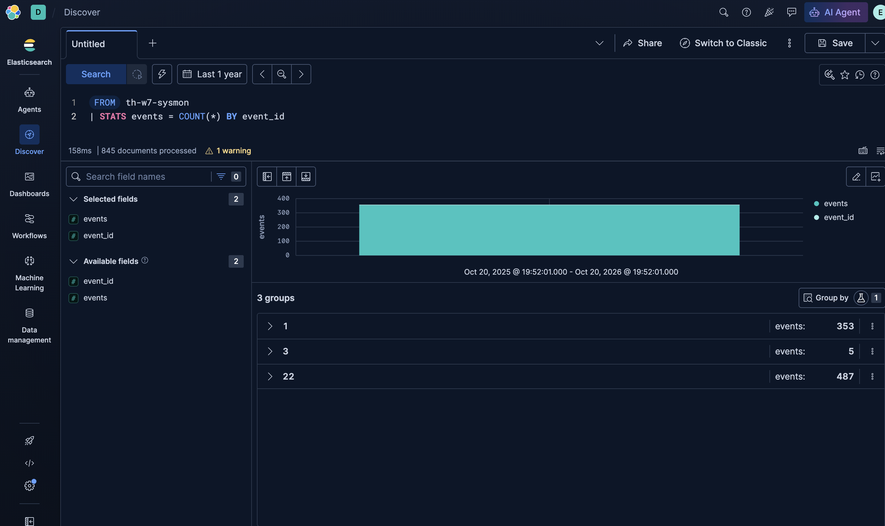 -->

## 6. Implementation in the SIEM

### 6.1 V0: the analytic exactly as published

The pseudocode translates almost word for word into ES|QL:

```sql
FROM th-w7-sysmon
| WHERE event_id == 1
  AND ENDS_WITH(TO_LOWER(image), "\\powershell.exe")          -- exe == "powershell.exe"
  AND NOT ENDS_WITH(TO_LOWER(parent_image), "\\explorer.exe") -- parent_exe != "explorer.exe"
| KEEP @timestamp, hostname, user, parent_image, command_line
```

| CAR data model | Sysmon field | Our index field |
|---|---|---|
| `process/create` | Event ID 1 | `event_id == 1` |
| `exe` | `Image` | `image` |
| `parent_exe` | `ParentImage` | `parent_image` |
| (not in CAR) | `OriginalFileName` | `original_file_name` |

**Result: 211 alerts, 3 of them real (M1, M2, M3), precision 1.4 %, M4 and M5 missed.** Stacking the alerts by parent (block V0b) shows where the noise comes from:

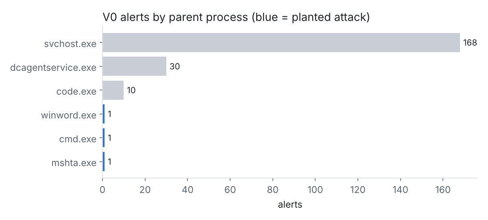
<!-- 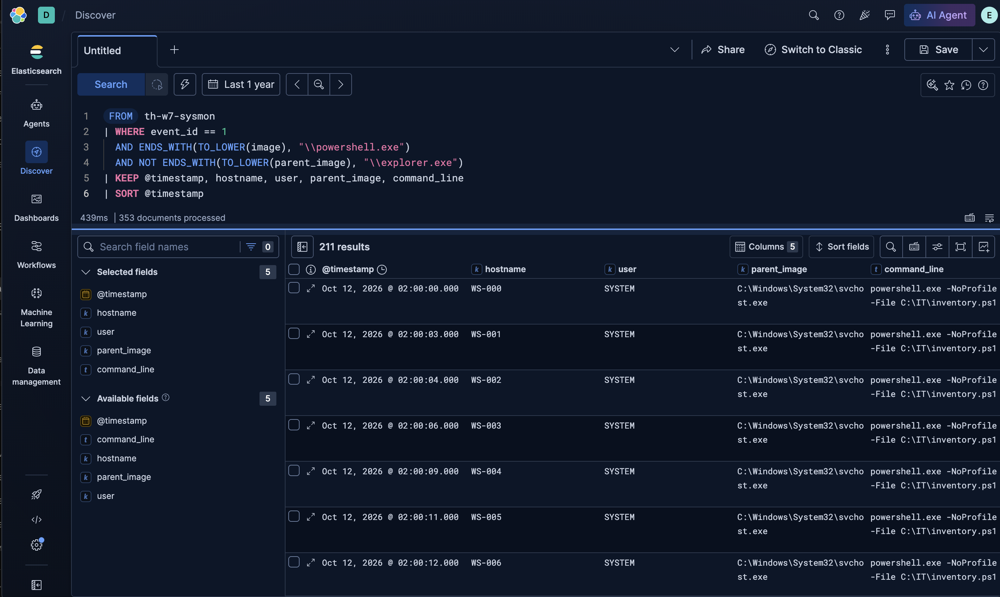 -->
<!-- 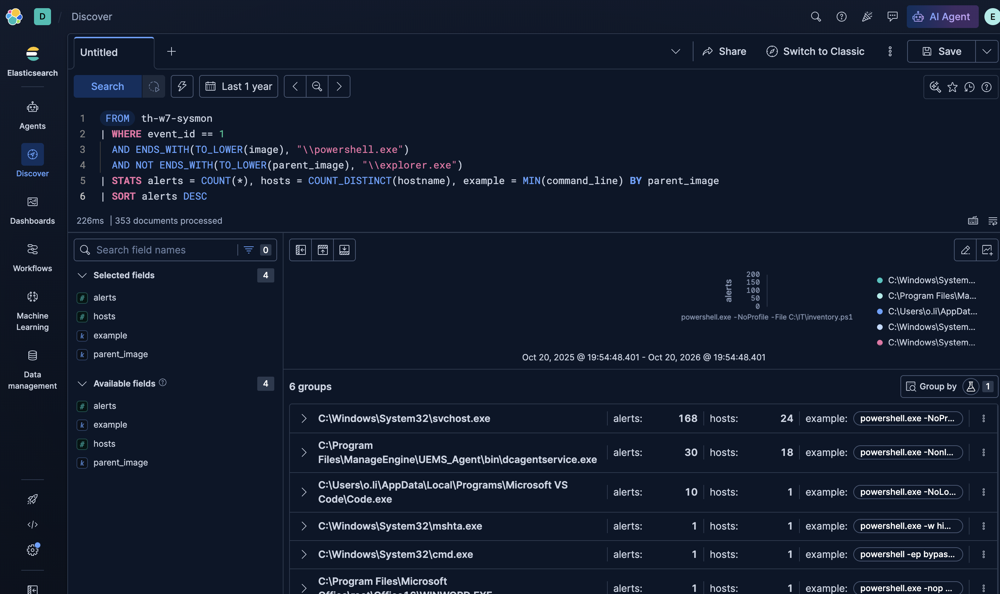 -->

A SOC would mute a rule that produces about 30 alerts a day with 98.6 % noise. CAR itself warns that legitimate software started from parents other than explorer.exe needs exclusions.

### 6.2 V1: allow-list from triage

Each of the three noisy parents was reviewed (same command line every time, SYSTEM or the expected user, known software path) and allow-listed **as a pair: parent + exact command line**. We did not exclude a parent on its own, because "ignore everything started by svchost.exe" would also ignore an attacker who uses a scheduled task.

**Result: 3 alerts, 3 real, 0 false positives.** But recall is still 3/5: tuning removed noise, it did not fix the blind spots. Block **V1-blind** looks for PowerShell (by `original_file_name`) that CAR never sees:

| Host | User | Parent → image | Runs | Verdict |
|---|---|---|---|---|
| WS-000 | it.admin | explorer.exe → powershell.exe | 15 | benign, interactive admin |
| WS-003 | d.omarov | explorer.exe → powershell.exe | 1 | **M4** CDEK .lnk |
| WS-017 | z.temirova | wscript.exe → winupdate.exe | 1 | **M5** renamed PowerShell |

This shows why CAR excludes explorer.exe (15 legitimate admin sessions) and why that exclusion is dangerous for phishing: a `.lnk` attachment is started by explorer.exe.

<!-- 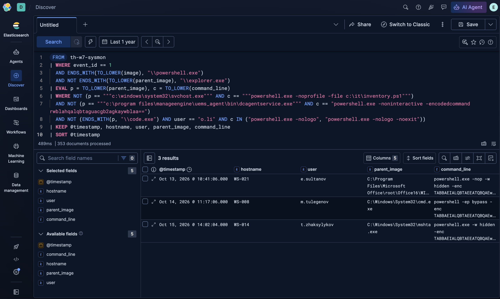 -->
<!-- 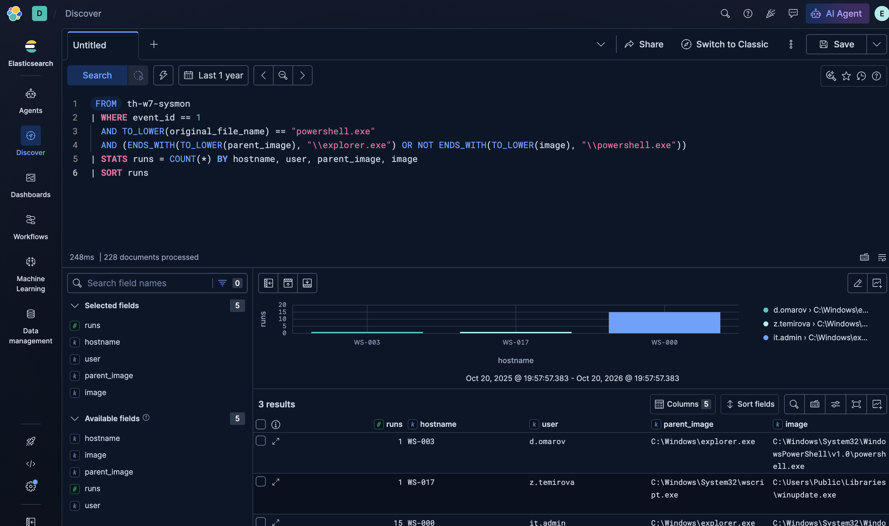 -->

### 6.3 V2: our detection

Two changes on top of V1:

1. **Identify PowerShell by `OriginalFileName`** (`PowerShell.EXE`, `pwsh.dll`), which is taken from the file's PE header and does not change when the file is renamed. Closes M5 (T1036.003).
2. **Keep the explorer.exe exclusion, but not for hidden or encoded starts**: `-e/-en/-enc/-EncodedCommand` or `-w/-WindowStyle hidden`. A human typing in a PowerShell window does not hide the window. Closes M4 (T1027.010).

**Result: 5 alerts, 5 real (M1–M5), 0 false positives.**

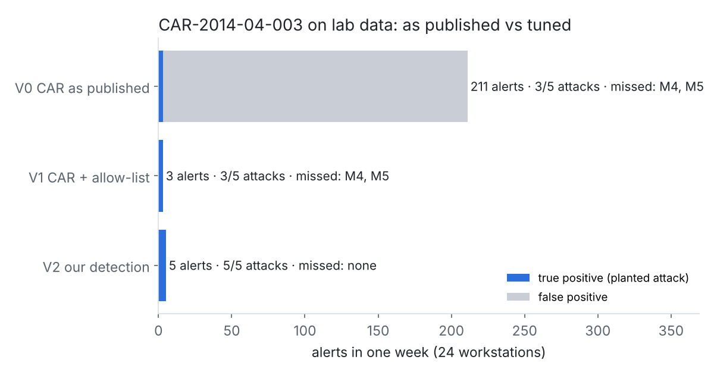
<!-- 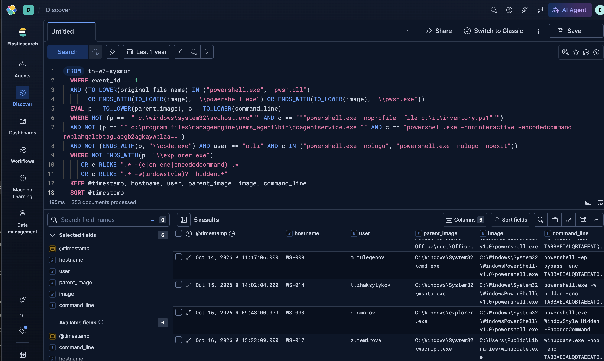 -->

Block **V2-chain** confirms each alert: within 2–3 seconds every one of the five hosts made a connection to 203.0.113.x:443 from the same PowerShell image.

<!-- 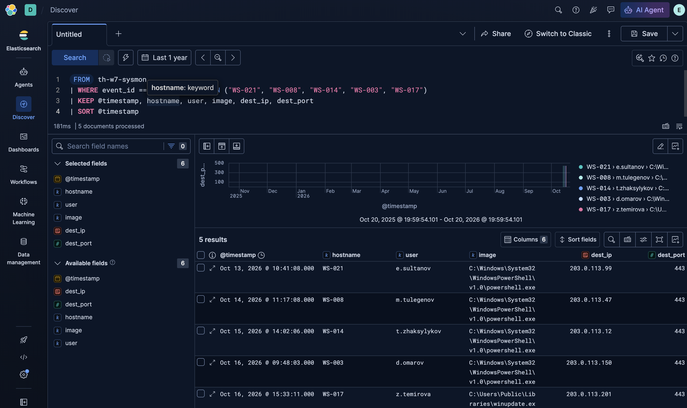 -->

### 6.4 Running it as a detection rule

The ES|QL query became a scheduled **Kibana Security detection rule** ([`rules/kibana_rule_w7_powershell.json`](rules/kibana_rule_w7_powershell.json)): ES|QL rule type, runs every 5 minutes, severity high, risk 73, ATT&CK mapping filled in so every alert carries the tactic and technique.

Create it in the UI: **Security → Rules → Detection rules → Create new rule → ES|QL**, paste the `query` from the JSON, then copy name, severity, MITRE ATT&CK mapping and schedule (interval 5m, additional look-back so that `from` = now-30d). Or create it with the API:

```bash
cd week-07
source ../elastic-start-local/.env 2>/dev/null   # ES_LOCAL_PASSWORD
for f in rules/kibana_rule_w7_powershell.json rules/kibana_rule_w7_car_as_published.json rules/kibana_rule_w7_brand_dns.json; do
  curl -s -u "elastic:$ES_LOCAL_PASSWORD" -X POST "http://localhost:5601/api/detection_engine/rules" \
       -H "kbn-xsrf: true" -H "Content-Type: application/json" --data @"$f" | head -c 300; echo
done
```

Notes:
- A non-aggregating ES|QL rule must read `METADATA _id, _index, _version` and keep those fields, so Kibana can de-duplicate alerts. Both rule files do that.
- A rule only sees events inside its look-back window (`from: now-30d`). If the defense is later than mid-November, regenerate the data with `python3 scripts/generate_w7_logs.py --shift-to-now` (moves the week so it ends one hour ago), re-import it, and the alerts appear on the next run.
- Expected in **Security → Alerts**: rule *W7 … tuned* = 5 alerts (WS-021, WS-008, WS-014, WS-003, WS-017); rule *as published* = 211 alerts; rule *brand look-alike domain* = 5 alerts (same hosts).

<!-- 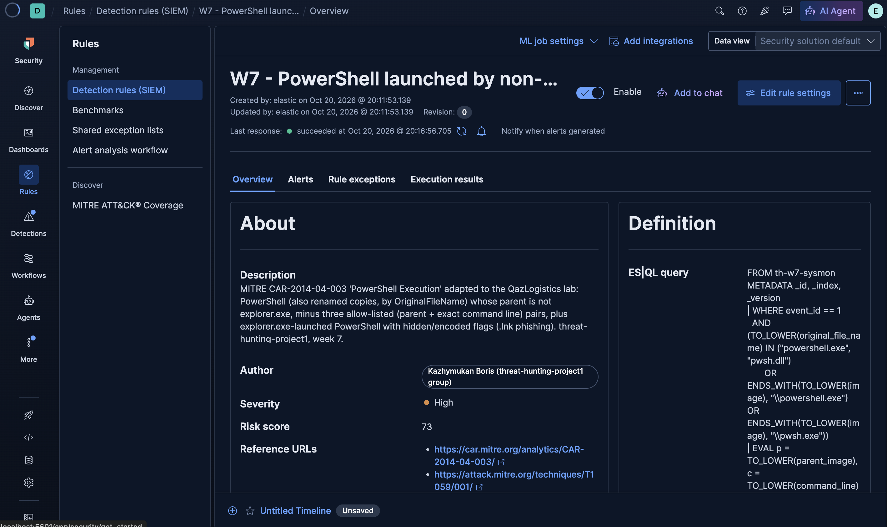 -->
<!-- 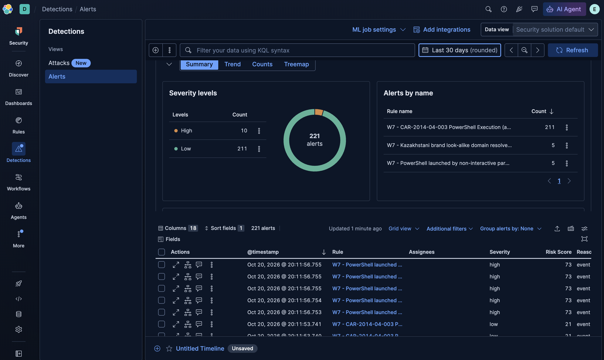 -->

### 6.5 Linking the alert to our topic: which brand campaign?

The CAR analytic answers "PowerShell was started by something other than the user". For our topic the analyst's next question is **"which phishing campaign is this, and is it one we already know?"** CAR has no analytic for phishing itself (T1566 is not on the CAR technique list), so we join the CAR alert with our own brand intelligence from earlier weeks:

- brand keywords: week-2 `config/brands.json` (kaspi, egov, kazpost, post.kz, cdek, halyk, homebank);
- official domains (must not be flagged): week-5 `config.py`;
- known IoCs: week-3 MISP event.

Block **V3** puts V2 alerts and brand DNS queries (Sysmon EID 22) together by host and image:

| Host | Image | Domain | Brand | Class | Verdict |
|---|---|---|---|---|---|
| WS-021 | powershell.exe | kazpost-delivery-track.net | Kazpost | known IoC (week-3 MISP) | phishing payload (M1) |
| WS-008 | powershell.exe | kaspi-bonus-2026.com | Kaspi | known IoC (week-3 MISP) | phishing payload (M2) |
| WS-014 | powershell.exe | eg0v-portal.kz | eGov | known IoC (week-3 MISP) | phishing payload (M3) |
| WS-003 | powershell.exe | cdek-nakladnaya.top | CDEK | **new look-alike** | phishing payload (M4) |
| WS-017 | winupdate.exe | kaspi-cashback.online | Kaspi | **new look-alike** | phishing payload (M5) |
| WS-005 | chrome.exe | kazpost-delivery-track.net | Kazpost | known IoC | link clicked, no execution: reset password, warn user |
| WS-012 | chrome.exe | cdekteam.ru | CDEK | look-alike | benign, known week-2 false positive |

What this shows for our topic:
- **All 5 alerts are attributed to a Kazakhstani brand campaign**, 3 to campaigns already in our MISP event and 2 to campaigns that **no feed knew** (M4, M5). The IoC list alone would have missed those two; the CAR behaviour catches them, and the brand keyword names them.
- **Domain-only hunting is noisier**: it also returns the WS-005 click and the cdekteam.ru false positive. The execution alert is what separates "user visited a fake page" from "malware is running".

From this we made a second, topic-specific rule, **V3-dns** ([`rules/kibana_rule_w7_brand_dns.json`](rules/kibana_rule_w7_brand_dns.json)): *a brand look-alike domain resolved by a process that is not a browser or Outlook*. Result: **5 alerts = M1–M5**, no browser noise. It does not depend on the process name, so it also catches the renamed winupdate.exe.

<!-- 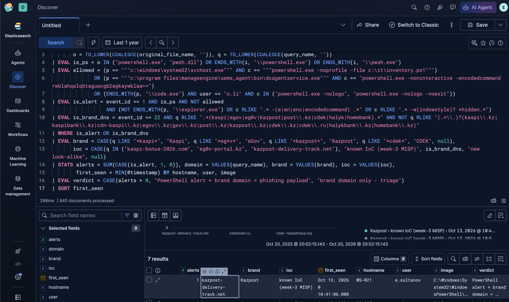 -->
<!-- 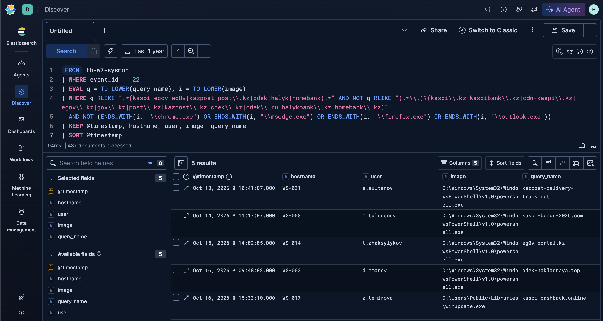 -->

The same logic is in [`queries/car_2014_04_003.spl`](queries/car_2014_04_003.spl) for Splunk (V2 can be saved as an alert) and in [`sigma-rules/rule-004-powershell-non-interactive-parent.yml`](sigma-rules/rule-004-powershell-non-interactive-parent.yml) for any SIEM.

## 7. Results

| Version | Alerts | True positives | False positives | Missed | Precision | Recall |
|---|---|---|---|---|---|---|
| V0 CAR as published | 211 | 3 (M1, M2, M3) | 208 | M4, M5 | 1.4 % | 3/5 |
| V1 CAR + allow-list | 3 | 3 | 0 | M4, M5 | 100 % | 3/5 |
| V2 our detection | 5 | 5 | 0 | none | 100 % | 5/5 |
| V3-dns brand look-alike, non-browser (topic rule) | 5 | 5 | 0 | none | 100 % | 5/5 |
| *week-5 rule-003 (Office → PowerShell), for comparison* | 1 | 1 (M1) | 0 | M2–M5 | 100 % | 1/5 |

Python ([`data/car_results.txt`](data/car_results.txt)), ES|QL and SPL give the same numbers on the same file.

**Comparison with week-5 rule-003** (WINWORD/EXCEL/OUTLOOK → powershell): rule-003 is very precise but only sees the direct Office → PowerShell pair. The CAR analytic looks at the problem from the other side, "who started PowerShell, if not the user", so it also catches cmd.exe and mshta.exe in the middle of the chain. Both are kept: rule-003 as a high-confidence subset, rule-004 for coverage.

**Comparison with week-6 Sigma rule** (Base64 piped into a Linux shell): both catch an encoded command, but the week-6 rule looks at the command line only, while the CAR analytic looks at the **parent–child relationship**, which an attacker cannot change by re-encoding the payload.

## 8. Mapping to ATT&CK

| Tactic | Technique | How it relates to the analytic | Source |
|---|---|---|---|
| Execution (TA0002) | **T1059.001 PowerShell** | Main target: PowerShell started by a non-interactive parent | CAR coverage: High |
| Defense Evasion (TA0005)* | T1059.001 PowerShell | PowerShell used to hide commands (`net use`, `sc start`) from other monitoring | CAR coverage: Moderate |
| Defense Evasion (TA0005)* | T1027.010 Command Obfuscation | `-enc` / hidden window in the explorer.exe branch (M4) | our tuning |
| Defense Evasion (TA0005)* | T1036.003 Rename Legitimate Utilities | `OriginalFileName` instead of file name (M5) | our tuning |
| Execution (TA0002) | T1204.002 Malicious File | The user opened .docm/.xlsm/.lnk/.js; the alert fires at this step | chain |
| Initial Access (TA0001) | T1566.001 Spearphishing Attachment | The lure: Kazpost, Kaspi, eGov, CDEK | chain |
| Defense Evasion (TA0005)* | T1218.005 Mshta | M3: mshta.exe is the parent in the alert | chain |
| Execution (TA0002) | T1059.003 Windows Command Shell, T1059.007 JavaScript | M2 (cmd.exe), M5 (wscript.exe) earlier in the chain | chain |
| Command and Control (TA0011) | T1071.004 DNS, T1071.001 Web Protocols | Payload resolves a brand look-alike and connects to it | **our topic rule V3-dns** |
| Resource Development (TA0042) | T1583.001 Acquire Infrastructure: Domains | Attacker registered Kaspi/eGov/Kazpost/CDEK look-alike domains | chain |
| Defense Evasion (TA0005)* | T1656 Impersonation | Lure impersonates a Kazakhstani brand | chain (group topic) |

\* In ATT&CK v20 Defense Evasion was split into Stealth (TA0005) and Defense Impairment (TA0112); see the version note in the week-6 report. Technique IDs are unchanged.

**Navigator:** open https://mitre-attack.github.io/attack-navigator/ → *Open Existing Layer* → *Upload from local* → [`navigator-layer-w7.json`](navigator-layer-w7.json). Red = covered by CAR as published, orange = added by our tuning and topic rule, yellow = related techniques in the chain.

<!-- 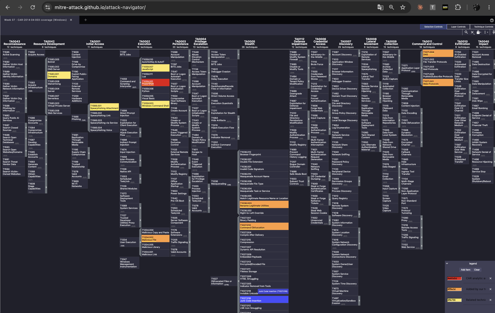 -->

Placed on the week-4 kill chain, the analytic sits at the **Exploitation / Installation** boundary: after the user opened the attachment, before the payload is downloaded. That is late for prevention, but early enough to isolate the host before credentials are stolen.

## 9. Limitations

- **Lab data.** The noise profile (svchost inventory, ManageEngine, VS Code) is invented to look like a small company; a real network has many more PowerShell parents (SCCM, Intune, installers, monitoring agents) and needs a longer triage period.
- **Allow-lists age.** When IT changes `inventory.ps1` or the agent's command, the pair no longer matches and the alerts come back. That is intended (fail loud), but it needs an owner.
- **Still evadable:** PowerShell without powershell.exe (System.Management.Automation loaded into another process), a hidden window set through a shortcut property instead of the command line, or a parent spoofed to explorer.exe. These need other analytics (module/DLL load events, script-block logging EID 4104).
- **Brand keywords are simple substrings**: a look-alike without the brand word (e.g. `qaz-posylka.kz`) is missed by V3-dns, but still caught by the CAR-based V2 rule.
- **Field quality.** The analytic depends on Sysmon EID 1 with `OriginalFileName`; plain Windows 4688 events do not have it.

## 10. Next steps

- Load the full week-3 MISP event into Kibana as a threat-intel index and replace the hard-coded IoC list with an *Indicator match* rule.
- Add CAR-2014-11-002 *Outlier Parents of Cmd* to see M2 one step earlier (Excel → cmd).
- Add CAR-2021-01-002 *Unusually Long Command Line Strings* as a second signal for encoded payloads.
- Forward the week-6 Kali auditd logs into the same Elastic stack, so the Linux and Windows detections live in one place.

## References

- MITRE CAR: https://car.mitre.org · CAR-2014-04-003: https://car.mitre.org/analytics/CAR-2014-04-003/
- CAR analytics by technique: https://car.mitre.org/analytics/by_technique
- ATT&CK T1059.001: https://attack.mitre.org/techniques/T1059/001/
- ATT&CK Navigator: https://mitre-attack.github.io/attack-navigator/
- Elastic ES|QL rules: https://www.elastic.co/guide/en/security/current/rules-ui-create.html
- Sigma: https://github.com/SigmaHQ/sigma
