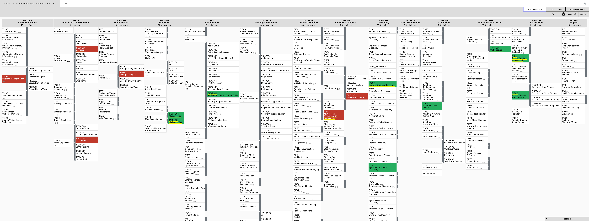
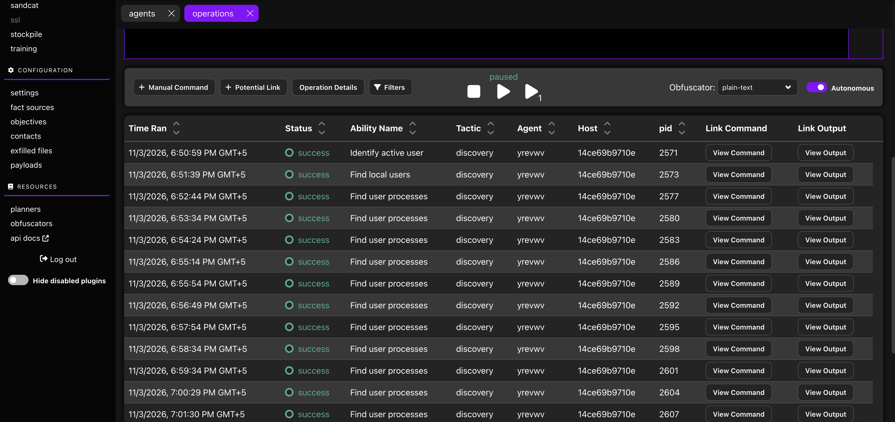

# Week 08: Creating a Plan to Emulate an Attacker's Action

**Group topic:** phishing campaigns impersonating Kazakhstani brands (Kaspi, eGov, Kazpost, CDEK)
**Syllabus tasks (3.3, week 8):** (1) develop a simple adversary emulation plan (initial access → persistence → data exfiltration); (2) document the plan using ATT&CK techniques.
**Topics:** adversary emulation plans. **Sources:** MITRE Engenuity, Red Teaming resources. **Recommended reading:** MITRE CALDERA documentation.
**Performed by:** Kazhymukan Boris, Ikhsan Muptiadil, Alizhan Onlazbek

> **Scope and ethics.** This is a *defensive* emulation plan for a lab exercise. It describes adversary behaviour at the level of ATT&CK techniques so we can build detections. No live phishing is sent to anyone, no lookalike site is hosted, and no malware is built. Any hands-on emulation (e.g. MITRE CALDERA) is run only inside an **isolated virtual lab** against machines we own.

---

## 1. Goal and scenario

A financially motivated actor runs a mass phishing campaign that impersonates well-known Kazakhstani brands (Kaspi, eGov, Kazpost, CDEK) to steal payment-card data and access to victims' accounts. We model the full chain so the blue team can answer: *if this happened to us, where would we see it, and how fast?*

**Why this scenario is realistic** (details and sources in [`osint-evidence.md`](osint-evidence.md)):
- Real Kaspi look-alikes seen by us in week 5: `kaspl[.]ga`, `kaspibank.auth-telegramm[.]ru`, `kaspiy-delfin.tarho05[.]ru`; historic case `kaspi-bannk[.]com` (fake login → SMS code, blocked by KZ-CERT).
- Kazpost and courier "parcel / missed delivery" lures via SMS and messengers are confirmed by Kazpost and media (2025–2026).
- eGov "payout" pages (`egov-kz-pay[.]online`) and KZ-CERT reports of 200+ fake bank/eGov resources.
- Main path in the wild = **credential/card/OTP theft through a web form**; the endpoint-implant branch (persistence → exfil) is the secondary path that we emulate in the lab.

**Emulation objective:** reproduce the observable behaviour of each phase in a controlled lab, map it to ATT&CK, and define a detection for every step.

## 2. Lab environment (for the emulation part)

| Component | Role |
|---|---|
| Isolated host-only network (no internet egress to real brands) | Containment |
| CALDERA server (Docker on the analyst host) | Orchestrates emulation |
| Victim VM (Linux/Windows) with a CALDERA agent | The "compromised" endpoint |
| Log collection (Sysmon / auditd → simple SIEM or file) | Detection evidence |

## 3. Emulation plan by phase (ATT&CK mapping)

| Phase | Adversary behaviour (modelled) | ATT&CK ID | Emulation scope |
|---|---|---|---|
| Reconnaissance | Collect target brand assets, logos, customer-facing wording | T1598 Phishing for Information | No — OSINT only |
| Resource Development | Register lookalike domains; stage a credential-capture page | T1583.001 Domains, T1608.005 Link Target | No — described only |
| **Initial Access** | Deliver a lure link via SMS / messenger impersonating a delivery or bonus notice | T1566.002 Spearphishing Link (mobile: T1660 Phishing) | No — described only |
| Execution | Victim opens the link / runs a delivered file | T1204.001 / T1204.002 User Execution | Planned: benign stand-in |
| Credential Access | Fake form harvests credentials / card data / OTP | T1056.003 Web Portal Capture, T1111 MFA Interception | No — described only |
| **Persistence** | Implant establishes autostart on the endpoint | T1547.001 Registry Run Keys, T1053.005 Scheduled Task | Planned (CALDERA) |
| Discovery | Enumerate host, user, files | T1082 System Info, T1083 File & Directory Discovery | Planned (CALDERA) |
| Collection | Stage data of interest for theft | T1005 Data from Local System | Planned (CALDERA) |
| Command & Control | Beacon to attacker infrastructure | T1071.001 Web Protocols | Planned (CALDERA) |
| **Exfiltration** | Send collected data out (e.g. over C2, or to a web service / bot) | T1041 Exfil over C2, T1567 Exfil over Web Service | Planned (CALDERA, lab sink) |

**Why the split.** The phases that require deceiving real people (recon of victims, lookalike domains, the lure, the fake form) are **documented, not performed** — performing them would mean attacking real users. Everything *after* a hypothetical compromise (persistence → exfil) is safe to emulate against a lab VM with harmless stand-in data, and that is exactly what CALDERA is for.

## 4. Deliverables in this folder

| File | What it is |
|---|---|
| this `README.md` | the emulation plan |
| [`osint-evidence.md`](osint-evidence.md) | OSINT backing: brand/KZ-CERT warnings, our confirmed domains from weeks 2 and 5, lure patterns |
| [`attack-chain.md`](attack-chain.md) | kill-chain diagram (Mermaid, renders on GitHub) |
| [`navigator-layer-w8.json`](navigator-layer-w8.json) | ATT&CK Navigator layer: red = documented only, green = planned for lab emulation |
| [`detection.md`](detection.md) | how to detect each phase |
| [`caldera/profile.yml`](caldera/profile.yml) | CALDERA adversary profile template for the post-compromise phases (lab only) |
| [`caldera/LAB-SETUP-mac.md`](caldera/LAB-SETUP-mac.md) | how to run CALDERA on macOS with Docker |
| [`screenshots/w8_navigator.png`](screenshots/w8_navigator.png) | the plan in ATT&CK Navigator |
| [`screenshots/caldera_*.png`](screenshots/) | CALDERA emulation run (agent, operation, command, output) |
| [`AI_USE_DECLARATION.md`](AI_USE_DECLARATION.md) | AI use declaration |

## 5. The plan in ATT&CK Navigator

▶ **[Open this layer live in ATT&CK Navigator](https://mitre-attack.github.io/attack-navigator/#layerURL=https%3A%2F%2Fraw.githubusercontent.com%2FAlizhan1212%2Fthreat-hunting-project1%2Fmain%2Fweek-08%2Fnavigator-layer-w8.json)** — loads the layer straight from this repo, interactive, not just the screenshot above.

Layer: [`navigator-layer-w8.json`](navigator-layer-w8.json) (Enterprise ATT&CK v15, 16 techniques). **Red** = documented only (would require deceiving real people). **Green** = planned for emulation in the isolated lab. The mobile technique T1660 (Phishing) is in the table above but not in the layer, because the layer covers Enterprise ATT&CK only.

## 6. CALDERA emulation (lab run)

We ran a live emulation in MITRE CALDERA 5.3.0 to show the mechanics end to end. CALDERA server and a Sandcat agent both ran in Docker on the analyst host; the agent ran inside a throwaway Ubuntu container (`14ce69b9710e`), so nothing touched a real system and no real brand or user was targeted.

Setup is in [`caldera/LAB-SETUP-mac.md`](caldera/LAB-SETUP-mac.md); the topic-specific profile is [`caldera/profile.yml`](caldera/profile.yml). For the live run we used CALDERA's built-in benign **Discovery** adversary to demonstrate the operation workflow safely.

| Step | Screenshot | What it shows |
|---|---|---|
| Agent deployed | [`caldera_1_agent.png`](screenshots/caldera_1_agent.png) | Sandcat agent `yrevwv` on host `14ce69b9710e`, group `red`, status alive/trusted |
| Operation ran | [`caldera_2_operation.png`](screenshots/caldera_2_operation.png) | Abilities executed (Identify active user, Find local users, Find user processes…), tactic `discovery`, status `success` |
| Command | [`caldera_3_command.png`](screenshots/caldera_3_command.png) | The real command run on the agent (`whoami`) for "Identify active user" (T1033 / T1082) |
| Output | [`caldera_4_output.png`](screenshots/caldera_4_output.png) | Collected facts: `host.user.name = root`, standard output `root` |

**Mapping to the plan.** The Discovery run exercises the Discovery phase of our plan (T1082, T1083). Our topic-specific `profile.yml` documents the fuller post-compromise chain (persistence → discovery → collection → exfiltration); its ability UUIDs are filled from the running CALDERA instance (abilities page). The pre-compromise phases (initial access, credential capture) stay documented only, since emulating them would mean deceiving real people.

## 7. Defence for each phase

See `detection.md`. Summary: domain-registration monitoring and brand-abuse takedown for the pre-compromise phases; endpoint and network telemetry (autostart changes, scheduled tasks, anomalous outbound to messaging/web-service endpoints) for the post-compromise phases.

## 8. Defence summary (what we would tell a defender)

The cheapest wins against this campaign are **upstream** (block/takedown of lookalike domains, user awareness for delivery-themed lures) and **downstream** (alert on new persistence + unusual egress). The middle of the chain is hard to catch per-user, which is exactly why the plan exists: it shows defenders where their visibility actually is.
