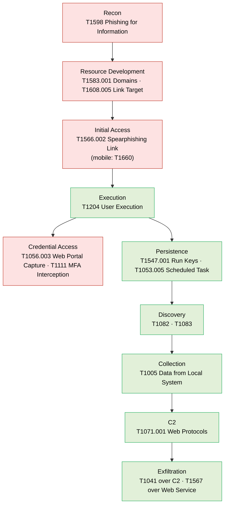

# Attack chain — phishing impersonating Kazakhstani brands

Conceptual kill chain for the emulation plan. Pre-compromise phases are *documented*; post-compromise phases are *emulated in an isolated lab*.

**Legend:** red = documented only (would require deceiving real people); green = safe to emulate in the lab against our own VM with harmless stand-in data.
