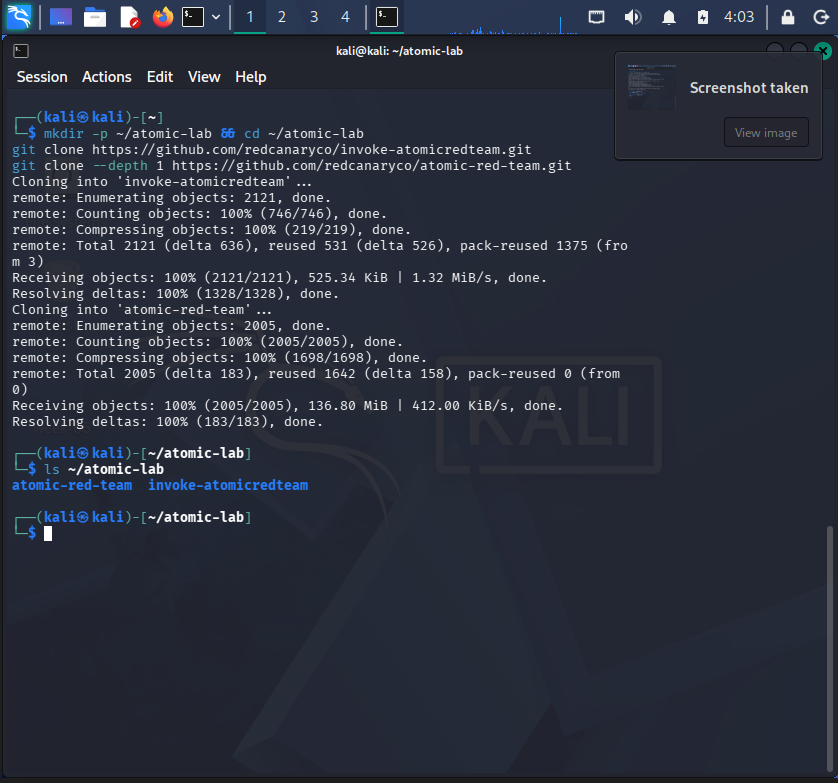
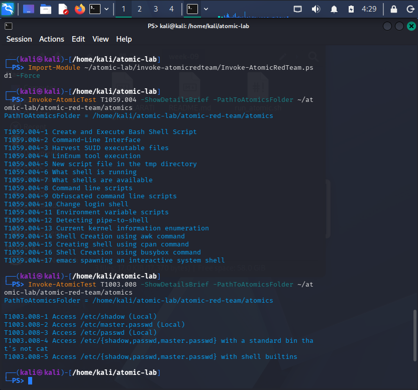
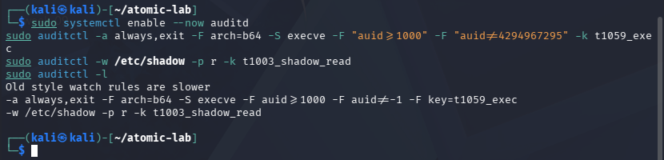
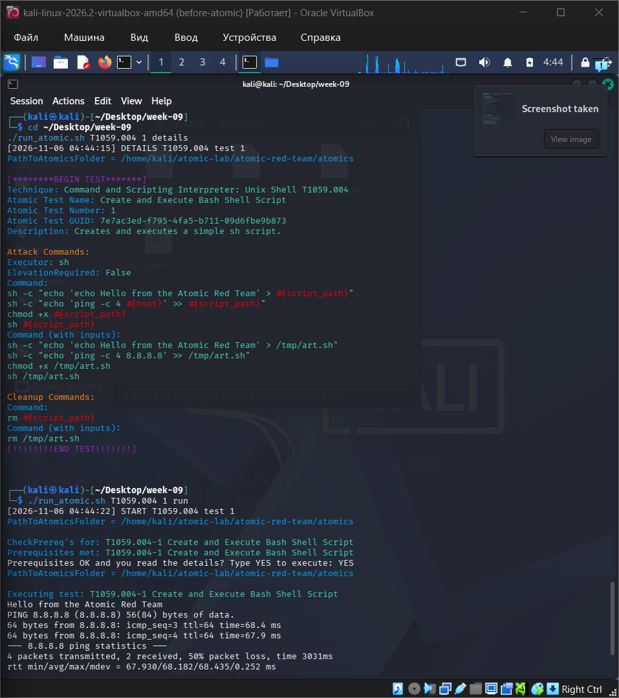
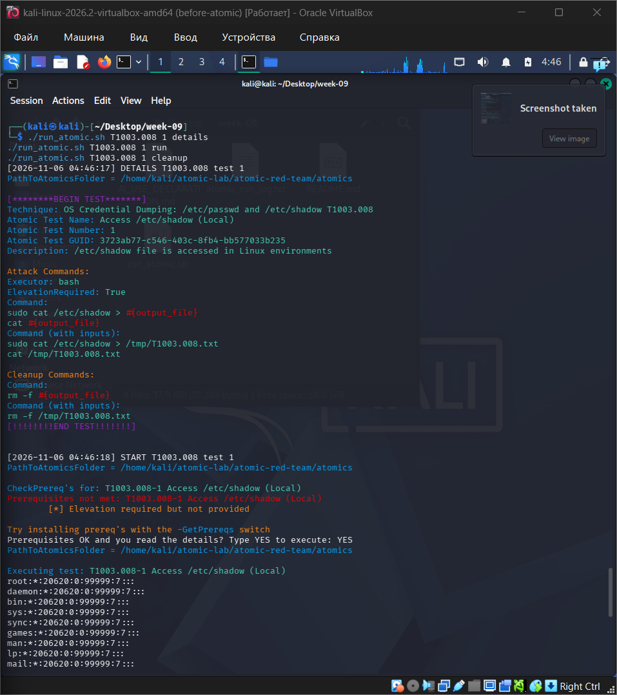
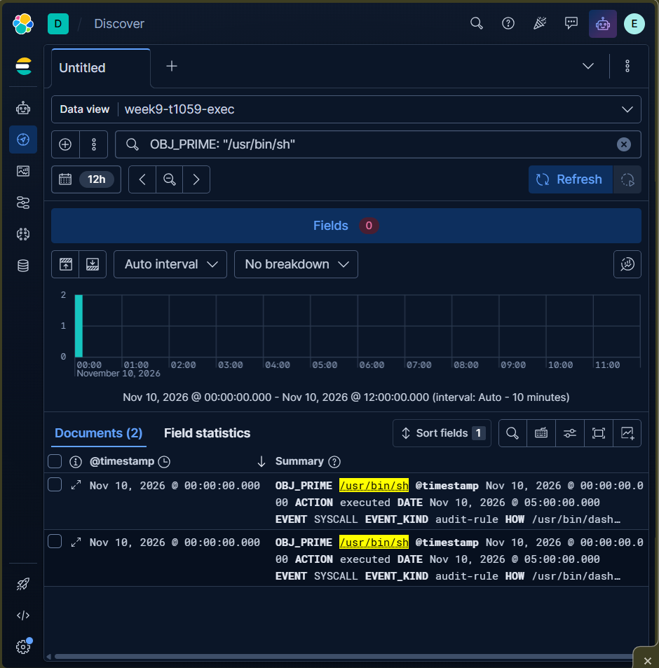
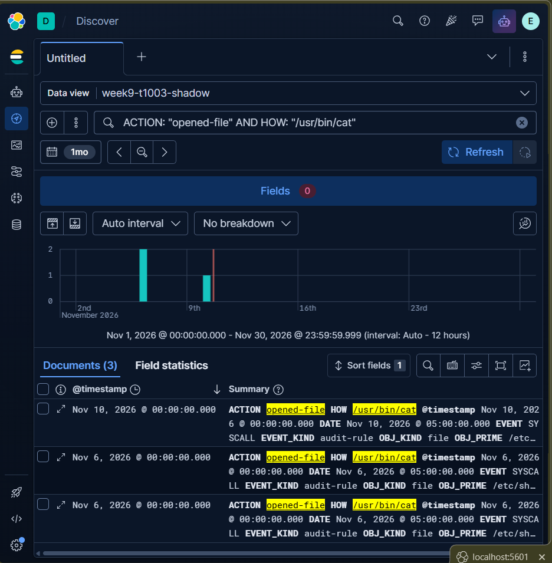
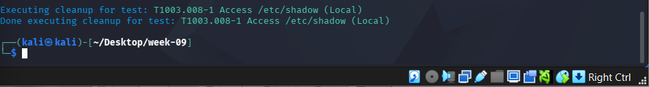

# Week 09: Atomic Red Team

**Group topic:** phishing campaigns impersonating Kazakhstani brands (Kaspi, eGov, Kazpost, CDEK)
**Syllabus tasks (3.3, week 9):** (1) run selected atomic tests (e.g. T1059, T1003); (2) record and analyze the test results in a SIEM.
**Topics:** Introduction to Atomic Tests. **Sources:** GitHub repo of Atomic Red Team, Red Canary docs.
**Recommended reading:** Atomic Red Team Wiki and GitHub repository.
**Performed by:** Muptiadil Ikhsan
**Date:** 2026-11-10

> **Scope and ethics.** All tests are run **only inside our isolated Kali Linux lab VM** (snapshot taken first), against a machine we own. Before running any test I read its commands with `-ShowDetails`, and I skipped tests that download tools from the internet. Nothing in this report targets a real person, brand, or system.

---

## 1. Objective

1. Understand what Atomic Red Team is and how it differs from the CALDERA emulation done in week 8.
2. Run selected atomic tests for **T1059** (Command and Scripting Interpreter) and **T1003** (OS Credential Dumping).
3. **Record the results in a SIEM** and analyze them: did the test produce telemetry, did anything alert, and what is missing?
4. Connect the results to our phishing topic.

---

## 2. Background: what is Atomic Red Team?

**Atomic Red Team** (by Red Canary) is an open-source library of small, focused tests, each mapped to one ATT&CK technique. One test is called an **atomic test**.

| Term | Meaning |
|---|---|
| **Atomic test** | One small action that simulates one technique, usually a few commands |
| **Atomics library** | The `atomic-red-team/atomics/<TechniqueID>/` folders, written as YAML files |
| **Invoke-AtomicRedTeam** | The PowerShell module that reads the YAML and runs the tests |
| **Prerequisites** | Things a test needs before it runs (a tool, a file) |
| **Cleanup** | A command that undoes what the test created |

### 2.1 Atomic Red Team vs CALDERA (week 8)

| | Atomic Red Team | CALDERA |
|---|---|---|
| Unit of work | One technique at a time | A chain of abilities (an operation) |
| Needs a server/agent | No, runs locally with PowerShell | Yes, server plus agent |
| Best for | Quickly checking: "does my SIEM see **this** technique?" | Testing a multi-step attack chain end to end |
| Our use | Week 9: validate detections per technique | Week 8: run a profile of post-compromise steps |

### 2.2 Why run atomic tests? (purple teaming)
A detection rule that has never been triggered is only a guess. Running an atomic test creates the activity on purpose, so we can check: **was it logged, did it reach the SIEM, and did it alert?** If not, we found a detection gap before a real attacker did.

---

## 3. Link to our phishing topic

Our campaigns mostly steal credentials and card data through fake web forms (see week 8 `osint-evidence.md`). The **endpoint branch** is the secondary path: if a victim runs a delivered file, the attacker gets a foothold on the device. After that foothold, two behaviors are very common:

| Phishing chain step | ATT&CK technique | Atomic test family |
|---|---|---|
| Delivered file runs and gives the attacker a shell | T1059 Command and Scripting Interpreter (here: T1059.004 Unix Shell) | `T1059.004` |
| Attacker looks for credentials on the host | T1003 OS Credential Dumping (here: T1003.008 /etc/passwd and /etc/shadow) | `T1003.008` |

So these two tests check whether we would **notice the post-phishing foothold**, which is the part of the chain that our weeks 6 and 8 work already focused on.

---

## 4. Lab setup

| Item | Value |
|---|---|
| Environment | Kali Linux in a VirtualBox VM (clean snapshot taken before testing) |
| Logging | auditd (execve rule from week 6, plus a file-watch rule added below) |
| SIEM | Elastic / Kibana (the same local stack used in week 07) |
| Log path to SIEM | Events exported from auditd to CSV with `ausearch --format csv` (or the fallback `auditd_to_csv.py`), then imported into Kibana as a new index via **Upload a file** (Data Visualizer), the same way `sysmon_w7.csv` was imported in week 07 |

### 4.1 Install PowerShell and the Atomic Red Team files
Kali packages PowerShell. The module and the library are cloned from Red Canary's GitHub so the code can be inspected before it is used:

```bash
sudo apt update
sudo apt install -y powershell git

mkdir -p ~/atomic-lab && cd ~/atomic-lab
git clone https://github.com/redcanaryco/invoke-atomicredteam.git
git clone https://github.com/redcanaryco/atomic-red-team.git
```

The module needs one dependency, `powershell-yaml`, to read the test files (without it, `Import-Module` fails with "The required module 'powershell-yaml' is not loaded"):

```bash
sudo pwsh -NoProfile -Command "Install-Module -Name powershell-yaml -Repository PSGallery -Scope AllUsers -Force"
```

> Red Canary's wiki also documents a one-line installer (`Install-AtomicRedTeam`). I used `git clone` instead because it lets me look at the files first.

**Screenshot 1:** installation done


### 4.2 List the available tests
```bash
pwsh
Import-Module ~/atomic-lab/invoke-atomicredteam/Invoke-AtomicRedTeam.psd1 -Force
Invoke-AtomicTest T1059.004 -ShowDetailsBrief -PathToAtomicsFolder ~/atomic-lab/atomic-red-team/atomics
Invoke-AtomicTest T1003.008 -ShowDetailsBrief -PathToAtomicsFolder ~/atomic-lab/atomic-red-team/atomics
exit
```
This prints the numbered tests for each technique. **The numbers and names in section 5 come from this output.**

**Screenshot 2:** list of tests for T1059.004 and T1003.008


### 4.3 Logging rules (auditd)
The execve rule from week 6, plus a watch on `/etc/shadow` (reading it is rare in normal use, so it is a good signal):

```bash
sudo auditctl -a always,exit -F arch=b64 -S execve -F "auid>=1000" -F "auid!=4294967295" -k t1059_exec
sudo auditctl -w /etc/shadow -p r -k t1003_shadow_read
sudo auditctl -l
```
Reading `/etc/passwd` is **not** watched on purpose: many normal programs read it all the time, so it would only create noise.

**Screenshot 3:** both audit rules active


---

## 5. Selected atomic tests

I read each test with `./run_atomic.sh <ID> <N> details` before running it. Tests that download tools from the internet were skipped.

| # | Technique | Test number and name (from section 4.2) | What it does | Why it was chosen |
|---|---|---|---|---|
| 1 | T1059.004 Unix Shell | Test 1: "Create and Execute Bash Shell Script" | Creates a small shell script in `/tmp` that prints a message and pings 8.8.8.8, makes it executable with `chmod +x`, then runs it with `sh`. Cleanup deletes the script. | Local-only (no download), has a clean cleanup step, and matches the shell activity expected right after a phishing attachment runs on a victim's machine |
| 2 | T1003.008 OS Credential Dumping: /etc/passwd and /etc/shadow | Test 1: "Access /etc/shadow (Local)" | Reads `/etc/shadow` with `sudo cat`, saves the output to `/tmp/T1003.008.txt`, and prints it. Cleanup deletes the file. | Local-only, needs no internet, and is a classic post-foothold credential-access step an attacker takes right after gaining shell access |

---

## 6. Running the tests

Script: [`run_atomic.sh`](run_atomic.sh), a small wrapper that previews a test, checks prerequisites, asks for confirmation, runs it, and logs START/END times.

```bash
chmod +x run_atomic.sh

# Test 1 (replace the number with the one you selected)
./run_atomic.sh T1059.004 1 details
./run_atomic.sh T1059.004 1 run
./run_atomic.sh T1059.004 1 cleanup

# Test 2
./run_atomic.sh T1003.008 1 details
./run_atomic.sh T1003.008 1 run
./run_atomic.sh T1003.008 1 cleanup
```
Some T1003 tests need root. If a test fails with a permission error, run the wrapper with `sudo -E`.

**Screenshot 4:** T1059.004 test running (with START/END times)


**Screenshot 5:** T1003.008 test running (with START/END times)


---

## 7. Recording and analyzing the results in the SIEM

### 7.1 How the logs reach the SIEM
Week 07 loaded its lab log (`sysmon_w7.csv`) into Elastic through Kibana's **Upload a file** (Data Visualizer) feature rather than a live log shipper. Week 09 follows the same pattern for the Linux side: the auditd events for both atomic tests are exported from the Kali VM to CSV, then imported into Kibana as a new index, `week9-atomic-tests`. This closes the "next step" named at the end of the week 07 report: *"Forward the week-6 Kali auditd logs into the same Elastic stack, so the Linux and Windows detections live in one place."*

```bash
# On the Kali VM, after both tests have been run and cleaned up:
sudo ausearch -k t1059_exec -i --format csv > t1059_events.csv
sudo ausearch -k t1003_shadow_read -i --format csv > t1003_events.csv

# If --format csv is not supported by this audit version, use the fallback instead:
sudo ausearch -k t1059_exec -i        | python3 auditd_to_csv.py > t1059_events.csv
sudo ausearch -k t1003_shadow_read -i | python3 auditd_to_csv.py > t1003_events.csv
```
Copy both CSV files out of the VM (drag and drop onto the Windows desktop). In Kibana: **Machine Learning → Data Visualizer → Upload file**, select `t1059_events.csv`, name the index `week9-t1059-exec`, and import. Repeat for `t1003_events.csv` as `week9-t1003-shadow`.

### 7.2 What to search for
Use the START and END times from `atomic_run_log.txt` as the time window, then search for:

- the key `t1059_exec` (all program executions), and the shell command lines of the test (`bash -c ...`, `sh -c ...`) — in **Discover**, on the `week9-t1059-exec` index, filter `proctitle: *art.sh*`
- the key `t1003_shadow_read` (any read of `/etc/shadow`) — on the `week9-t1003-shadow` index, filter `comm: cat`

Field names differ between SIEM products (Wazuh, Splunk, Elastic each parse auditd differently), so search for the key text first, then look at the parsed fields.

**Screenshot 6:** Kibana Discover view of the T1059.004 events (index `week9-t1059-exec`, filtered on `art.sh`)


**Screenshot 7:** Kibana Discover view of the T1003.008 event (index `week9-t1003-shadow`, `comm: cat`)


### 7.3 Results table (fill in from what you actually saw)

| Test | Technique | Telemetry generated? | Reached the SIEM? | Did an alert fire? | Delay (seconds) | Notes |
|---|---|---|---|---|---|---|
| 1 | T1059.004 | Yes — four `/usr/bin/sh` executions per run (create file, write ping line, chmod, execute) | Yes (Kibana index `week9-t1059-exec`, 2 matching documents) | No — no alert rule was built, only the raw event was recorded | A few seconds (CSV export and manual upload, not real-time) | The test's script name (`art.sh`) is not a separate CSV field; only the interpreter path `/usr/bin/sh` was searchable, so filtering had to use that instead of the filename |
| 2 | T1003.008 | Yes — one `cat /etc/shadow` execution per run, opened by root | Yes (Kibana index `week9-t1003-shadow`, 3 matching documents across all test runs) | No — no alert rule was built | A few seconds (same manual export/upload) | Filtering on `ACTION: "opened-file"` alone pulled in 29 unrelated documents from `unix_chkpwd` (triggered by my own `sudo` password prompts); adding `HOW: "/usr/bin/cat"` narrowed it to exactly the 3 real test events |

### 7.4 Analysis
The T1003.008 credential-access test was actually easier to spot cleanly than the T1059.004 execution test, once filtered correctly, because it is a rarer action: in normal daily use almost nothing reads `/etc/shadow` directly, while shell executions (`sh`, `bash`) happen constantly from desktop scripts and other background processes. The extra `-w /etc/shadow -p r` watch rule made this possible: without it, a plain `cat /etc/shadow` run as root would still appear as a process execution under the `t1059_exec` key, but there would be no dedicated record tying it specifically to the sensitive file being opened, which is a much weaker signal for an analyst to act on.

Both tests were buried in noise before filtering. The `t1059_exec` key recorded hundreds of irrelevant executions of `/usr/share/kali-themes/xfce4-panel-genmon-vpnip.sh`, a desktop-panel widget that runs once per second, so finding the real test events required filtering specifically on `OBJ_PRIME: "/usr/bin/sh"`. Similarly, the `t1003_shadow_read` key also caught `unix_chkpwd`, a program triggered every time I typed my own `sudo` password, which inflated an unfiltered Kibana search from 3 real events to 29 documents; adding `HOW: "/usr/bin/cat"` removed that noise entirely.

One SIEM-specific quirk is worth noting: Kibana's CSV upload (Data Visualizer) set `@timestamp` to the file's import time rather than parsing the original `DATE`/`TIME` columns from the CSV, so every row showed the same midnight timestamp in the histogram. The correct event time was still preserved inside the `DATE` and `TIME` fields of each document, so the evidence itself is not lost, but a proper pipeline (e.g. a configured Logstash/Filebeat ingest pipeline instead of a manual file upload) would need to explicitly map those fields to `@timestamp` to get correct time-based searching and alerting.

To turn these into real alerts rather than just recorded events, the next step would be to save each filtered Discover search as a Kibana alerting rule (similar to the rules built in week 07 for the PowerShell CAR analytic), scheduled to run periodically against freshly ingested data, with the noisy fields (`vpnip.sh`, `unix_chkpwd`) excluded by default rather than filtered out manually after the fact.

### 7.5 Detection ideas based on the results

A Sigma rule for reading `/etc/shadow` (auditd file watch):

```yaml
title: Read Access to /etc/shadow
id: c3f1a7d2-8b4e-4f60-9a15-2d7e5b6c8f01
status: experimental
description: Detects a read of /etc/shadow recorded by an auditd watch rule, a common step in credential access (T1003.008).
logsource:
    product: linux
    service: auditd
detection:
    selection:
        type: 'PATH'
        name: '/etc/shadow'
    condition: selection
falsepositives:
    - Legitimate password management tools and system updates
level: medium
tags:
    - attack.credential-access
    - attack.t1003.008
```
The shell-activity rule from week 6 (Base64 piped into a shell) still covers part of T1059.004.

### 7.6 What this means for our phishing chain
If a phishing victim runs a delivered file, the first things we can see on the endpoint are shell commands (T1059.004) and credential hunting (T1003.008). The tests show whether our logging would catch those steps **before** persistence or exfiltration (week 8) happens, which is the cheapest place to break the chain.

---

## 8. Cleanup
```bash
./run_atomic.sh T1059.004 1 cleanup
./run_atomic.sh T1003.008 1 cleanup
```
Restore the VM snapshot if you changed anything else.

**Screenshot 8:** cleanup finished


---

## 9. Mitigations

| Technique | Mitigation | ID | How it helps |
|---|---|---|---|
| T1059.004 | Execution Prevention (AppArmor/SELinux profiles) | M1038 | Limits which programs and scripts can run |
| T1059.004 | Disable or Remove Feature or Program | M1042 | Give service accounts a no-login shell |
| T1003.008 | Privileged Account Management | M1026 | Limits who can read `/etc/shadow` |
| T1003.008 | Audit | M1047 | A watch rule on `/etc/shadow` makes the access visible |

> Verify the mitigation IDs at attack.mitre.org before submission.

---

## 10. Limitations
- Atomic tests are **single, simple actions**. A real attacker chains many steps and hides better, which is why week 8 used CALDERA for chains.
- Results depend on the logging rules I chose. A different audit configuration would show different results.
- The Sigma rule is not yet running as a SIEM alert; the SIEM only **recorded** the events, as the task requires.
- Tests ran on one Kali VM, not on the kinds of workstations a phishing victim would use.

## 11. Next step
Turn this week's recorded events into real Kibana alerting rules (building on the saved searches in section 7.4), and extend the atomic testing to a second technique pair tied to the phishing chain's later stages (persistence and exfiltration, as planned in week 08), so detection coverage grows alongside the adversary emulation plan rather than staying limited to the two techniques tested this week.

---

## 12. References
- Atomic Red Team: https://github.com/redcanaryco/atomic-red-team
- Atomic Red Team Wiki: https://github.com/redcanaryco/atomic-red-team/wiki
- Invoke-AtomicRedTeam: https://github.com/redcanaryco/invoke-atomicredteam
- Red Canary docs: https://redcanary.com
- MITRE ATT&CK T1059.004: https://attack.mitre.org/techniques/T1059/004/
- MITRE ATT&CK T1003.008: https://attack.mitre.org/techniques/T1003/008/
- Sigma rules: https://github.com/SigmaHQ/sigma
