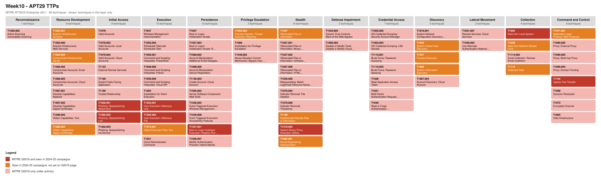
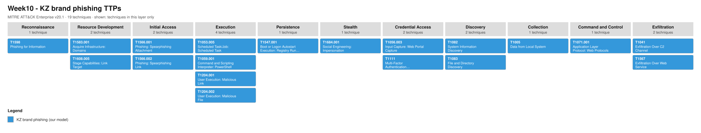
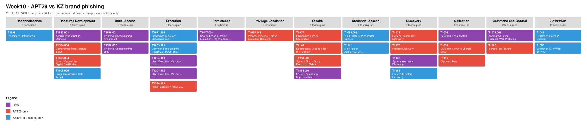
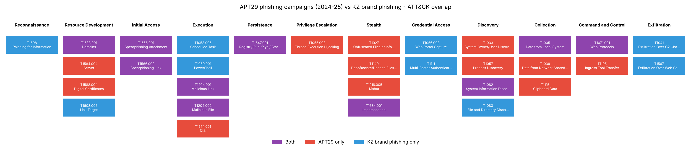

# Week 10: Learning APT Techniques (APT29)

**Group topic:** phishing campaigns impersonating Kazakhstani brands (Kaspi, eGov, Kazpost, CDEK)
**Syllabus tasks (3.3, week 10):** (1) analyze the TTPs of APT29 or APT41; (2) map the observed techniques to the MITRE ATT&CK framework.
**Topics:** case studies of APT groups. **Sources:** FireEye/Mandiant reports, CrowdStrike Global Threat Report. **Recommended reading:** Mandiant APT1 Report, CrowdStrike Global Threat Report.
**Performed by:** Kazhymukan Boris, Ikhsan Muptiadil, Alizhan Onlazbek

---

## 1. Why APT29 and not APT41

| | APT29 | APT41 |
|---|---|---|
| Sponsor / motive | Russia, SVR; espionage | China; espionage + financial crime |
| Main initial access | **Spear-phishing** (links, attachments, lures that impersonate trusted organizations) | Exploiting public-facing apps, supply chain |
| Link to our topic | Direct: same delivery idea as our KZ-brand phishing (impersonate a trusted brand → user clicks → payload or data theft) | Weak: phishing is a minor vector |

We chose **APT29** because its main tradecraft is phishing that impersonates trusted organizations, which is exactly what our group studies (phishing that impersonates Kaspi, eGov, Kazpost, CDEK). Comparing the two lets us see which techniques a state actor and a mass financial phisher share, and where they differ.

## 2. Group profile

| Field | Value |
|---|---|
| MITRE ID | [G0016](https://attack.mitre.org/groups/G0016/) |
| Names | APT29, Cozy Bear, The Dukes, NOBELIUM, Midnight Blizzard, UNC2452, IRON RITUAL |
| Attribution | Russian Foreign Intelligence Service (SVR) |
| Targets | Governments, diplomats, ministries of foreign affairs, political parties, think tanks, NGOs, IT and cloud providers |
| Goal | Long-term intelligence collection |
| Known campaigns in ATT&CK | C0024 SolarWinds Compromise (2019–2021), C0023 Operation Ghost (2013–2019) |
| Size of profile | 66 techniques and 49 pieces of software on the MITRE page (ATT&CK v20.1) |

Notable software: EnvyScout / ROOTSAW (HTML/HTA dropper), WINELOADER, GRAPELOADER, Cobalt Strike, SUNBURST, Mimikatz.

### 2.1 Why APT29 is linked to Russia and APT41 to China

Neither state admits these operations; the link (attribution) comes from governments and security vendors combining several kinds of evidence.

**APT29 → Russia (SVR)**
- **Government attribution:** on 15 April 2021 the US government formally attributed the SolarWinds campaign to Russia's Foreign Intelligence Service (SVR) "with high confidence", sanctioned six Russian technology companies that support SVR cyber operations and expelled 10 Russian diplomats.
- **Intelligence insight:** according to de Volkskrant and Nieuwsuur (January 2018), Dutch intelligence gained access to the group's network in 2014, including a CCTV camera at its office, and identified people entering the office as employees of the Russian Foreign Intelligence Service.
- **Technical evidence from vendors:** malware lineage from one campaign to the next (the "Duke" families), and targets that match Russian foreign-intelligence interests (ministries of foreign affairs, NATO governments, diplomats).

**APT41 → China**
- **Indictments:** in September 2020 the US Department of Justice charged five Chinese nationals as members of APT41; prosecutors described their employer, Chengdu 404 Network Technology, as a cover company for the hacking. More than 100 victims were named worldwide.
- **Vendor research:** Mandiant describes APT41 as a group that runs state-directed espionage and, in parallel, financially motivated crime (theft of virtual currency from game companies, ransomware, cryptojacking), hence the name "Double Dragon".

### 2.2 Known campaigns in ATT&CK: what happened

**C0024 — SolarWinds Compromise (2019–2021).** APT29 broke into the network of SolarWinds, the vendor of the Orion IT-monitoring platform. On the build server it planted **SUNSPOT**, which silently inserted the **SUNBURST** backdoor into Orion while the product was being compiled. The trojanized update shipped with SolarWinds' genuine digital signature, so customers installed it themselves; SolarWinds reported that fewer than 18,000 customers downloaded it. The group then picked only high-value victims for a second stage (TEARDROP, Raindrop, Cobalt Strike). **Outcome:** at least nine US federal agencies and about 100 companies were second-stage victims (including Microsoft); the intrusion was discovered in December 2020 when FireEye (now Mandiant) found it in its own network; in April 2021 the US formally blamed the SVR and imposed sanctions. Lesson: compromise one trusted supplier and the victims install the backdoor for you.

**C0023 — Operation Ghost (2013–2019).** After the loud 2015–2016 operations many assumed the group had gone quiet, but it kept spying on the ministries of foreign affairs of at least three European countries and on the Washington embassy of an EU member state. It used new "Duke" malware (**PolyglotDuke**, **RegDuke**, **FatDuke**) plus an updated **MiniDuke** backdoor. To stay hidden, infected machines read the encoded addresses of their command servers from ordinary posts on Twitter, Reddit and Imgur, payloads and commands were hidden inside images (steganography), and RegDuke used Dropbox as its C2. **Outcome:** ESET exposed the campaign in October 2019 and linked it to APT29 with high confidence through shared code, the same targets and the same tactics as earlier Duke operations. Lesson: social-media and cloud traffic can carry C2 that looks like normal browsing.

## 3. Case studies: three phishing campaigns (2024–2025)

We picked three recent campaigns where phishing was the entry point, because they are the closest to our topic.

### 3.1 Campaign A: WINELOADER against German political parties (Mandiant, March 2024)

| Kill chain stage | What happened |
|---|---|
| Lure | E-mail invitation to a dinner reception on 1 March 2024, with the CDU party logo, written in German |
| Delivery | Attached German-language lure document with a link to `waterforvoiceless[.]org/invite.php`, a **compromised WordPress site**, which served a ZIP with `invite.hta` |
| Execution | ROOTSAW (EnvyScout) HTA runs, downloads `invite.txt`, decodes it with `certutil -decode`, unpacks with `tar` |
| Side-loading | Legitimate `SqlDumper.exe` loads malicious `vcruntime140.dll` = WINELOADER |
| Stealth | RC4-encrypted core module, bypass of ntdll hooks, thread execution hijacking |
| C2 | HTTP GET beacons to `siestakeying[.]com/auth.php` with user name, device name, process name |
| Persistence | Run key created by a C2 command (reported by Zscaler) |

Source: [Mandiant / Google Cloud blog](https://cloud.google.com/blog/topics/threat-intelligence/apt29-wineloader-german-political-parties). Mandiant notes this was the first time this APT29 sub-cluster went after political parties rather than diplomats.

### 3.2 Campaign B: signed RDP files to 100+ organizations (Microsoft, October 2024)

| Kill chain stage | What happened |
|---|---|
| Lure | E-mails about Microsoft, AWS and "Zero Trust"; some **impersonated Microsoft employees** |
| Delivery | Attached `.rdp` configuration file **signed with a Let's Encrypt certificate** |
| Execution | User opens the `.rdp` file → Windows connects to the attacker's RDP server |
| Collection | The session exposes the victim's local drives, network drives, clipboard, printers, smart cards, Windows Hello / passkeys |
| Persistence | Microsoft warns the attacker **could** drop malware into AutoStart locations or install a RAT (possible, not observed) |
| Scale | Thousands of targets in 100+ organizations (government, academia, defense, NGOs), mostly UK, Europe, Australia, Japan |

Source: [Microsoft Threat Intelligence](https://www.microsoft.com/en-us/security/blog/2024/10/29/midnight-blizzard-conducts-large-scale-spear-phishing-campaign-using-rdp-files/). Microsoft calls the signed RDP file a new access vector for this actor. No malware is needed in the first stage: a built-in Windows feature does the work.

### 3.3 Campaign C: GRAPELOADER "wine tasting" lures to diplomats (Check Point, April 2025)

| Kill chain stage | What happened |
|---|---|
| Lure | E-mails that **impersonate a European Ministry of Foreign Affairs** and invite diplomats to a wine tasting / diplomatic dinner |
| Delivery | Link to `wine.zip`; the server sometimes redirects to the real ministry site instead (gated delivery) |
| Execution | `wine.exe` (a legitimate PowerPoint binary) side-loads `ppcore.dll` = GRAPELOADER |
| Persistence | Copies itself to `AppData\Local\POWERPNT\` and adds a `POWERPNT` value under the Run key |
| Discovery | Fingerprints user name, computer name, process |
| C2 | HTTPS POST to `ophibre[.]com` every 60 s; later stage WINELOADER (`vmtools.dll`) talks to `bravecup[.]com` |

Source: [Check Point Research](https://research.checkpoint.com/2025/apt29-phishing-campaign/).

### 3.4 What repeats across the three campaigns

1. **Impersonation of a trusted organization** (a party, Microsoft, a ministry) is the core of every lure.
2. **The user does the work**: a click or opening a file is required in all three.
3. **Legitimate binaries** carry the malicious code (DLL side-loading of `SqlDumper.exe`, PowerPoint; built-in RDP client).
4. **Persistence via the Run key**: observed in C (Check Point) and A (reported by Zscaler); in B it is the possible next step Microsoft warns about.
5. **Ordinary HTTPS** for C2, so the traffic blends in.

## 4. Mapping to MITRE ATT&CK

ATT&CK version: **v20.1** (in v20 MITRE split *Defense Evasion* into **Stealth** and **Defense Impairment**, and moved *Impersonation* from T1656 to **T1684.001**; we use the new IDs).

| Tactic | Technique | ID | Campaign | How APT29 used it |
|---|---|---|---|---|
| Resource Development | Compromise Infrastructure: Server | T1584.004 | A | Compromised WordPress site hosts ZIP / HTA |
| Resource Development | Acquire Infrastructure: Domains | T1583.001 | C | Sender domains `bakenhof[.]com`, `silry[.]com` |
| Resource Development | Obtain Capabilities: Digital Certificates | T1588.004 | B | Let's Encrypt certificate signs the RDP file |
| Initial Access | Spearphishing Attachment | T1566.001 | A, B | Attached lure document with a link; `.rdp` attachment |
| Initial Access | Spearphishing Link | T1566.002 | A, C | Link to `invite.php` / `wine.zip` |
| Stealth | Impersonation | T1684.001 | A, B, C | Poses as CDU, Microsoft/AWS staff, a European MFA |
| Execution | User Execution: Malicious Link | T1204.001 | A, C | Victim clicks the invitation link |
| Execution | User Execution: Malicious File | T1204.002 | A, B, C | Victim opens `invite.hta`, `.rdp`, `wine.exe` |
| Stealth | System Binary Proxy Execution: Mshta | T1218.005 | A | ROOTSAW runs as an HTA |
| Stealth | Deobfuscate/Decode Files or Information | T1140 | A | `certutil -decode` rebuilds the payload |
| Command and Control | Ingress Tool Transfer | T1105 | A, C | Second stage downloaded after the click |
| Execution / Stealth | Hijack Execution Flow: DLL (side-loading) | T1574.001 | A, C | `SqlDumper.exe` → `vcruntime140.dll`; `wine.exe` → `ppcore.dll` |
| Stealth | Obfuscated Files or Information | T1027 | A, C | RC4-encrypted core module, junk-code DLL |
| Privilege Escalation / Stealth | Process Injection: Thread Execution Hijacking | T1055.003 | A | WINELOADER (Mandiant ATT&CK table) |
| Persistence | Boot or Logon Autostart: Registry Run Keys | T1547.001 | A, B, C | Run key `POWERPNT` (C); Run key per Zscaler (A); AutoStart possible after RDP access (B) |
| Discovery | System Information Discovery | T1082 | A, C | Host fingerprint in first beacon |
| Discovery | System Owner/User Discovery | T1033 | A, C | User name in first beacon |
| Discovery | Process Discovery | T1057 | A | Mandiant ATT&CK table |
| Collection | Data from Local System | T1005 | B | Local drives exposed over RDP |
| Collection | Data from Network Shared Drive | T1039 | B | Network drives exposed over RDP |
| Collection | Clipboard Data | T1115 | B | Clipboard redirected over RDP |
| Command and Control | Application Layer Protocol: Web Protocols | T1071.001 | A, C | HTTPS GET/POST beacons |

**22 techniques** from the three campaigns. Only **8 of them** are already linked to APT29 on the MITRE G0016 page; the other 14 come from the recent reports. This shows why an analyst should read fresh vendor reports and not rely on the ATT&CK group page alone.

## 5. ATT&CK Navigator layers

| File | What it shows |
|---|---|
| [`navigator/apt29_layer.json`](navigator/apt29_layer.json) | All 66 MITRE G0016 techniques + our 22 campaign techniques (80 in total). Dark red = on G0016 and seen in 2024–25; orange = seen in 2024–25 only; pink = G0016 only |
| [`navigator/kz_phishing_layer.json`](navigator/kz_phishing_layer.json) | Our KZ-brand phishing model (19 techniques, from the week 8 plan and weeks 5/7) |
| [`navigator/comparison_layer.json`](navigator/comparison_layer.json) | Overlap: purple = both, red = APT29 only, blue = KZ phishing only |

Open live in Navigator:
- ▶ [APT29 layer](https://mitre-attack.github.io/attack-navigator/#layerURL=https%3A%2F%2Fraw.githubusercontent.com%2FAlizhan1212%2Fthreat-hunting-project1%2Fmain%2Fweek-10%2Fnavigator%2Fapt29_layer.json)
- ▶ [KZ phishing layer](https://mitre-attack.github.io/attack-navigator/#layerURL=https%3A%2F%2Fraw.githubusercontent.com%2FAlizhan1212%2Fthreat-hunting-project1%2Fmain%2Fweek-10%2Fnavigator%2Fkz_phishing_layer.json)
- ▶ [Comparison layer](https://mitre-attack.github.io/attack-navigator/#layerURL=https%3A%2F%2Fraw.githubusercontent.com%2FAlizhan1212%2Fthreat-hunting-project1%2Fmain%2Fweek-10%2Fnavigator%2Fcomparison_layer.json)

### SVG exports of the layers

| APT29 TTPs | KZ brand phishing | APT29 vs KZ phishing |
|---|---|---|
| [`svg/apt29_layer.svg`](svg/apt29_layer.svg) | [`svg/kz_phishing_layer.svg`](svg/kz_phishing_layer.svg) | [`svg/comparison_layer.svg`](svg/comparison_layer.svg) |







The SVGs show only the techniques in each layer, in ATT&CK Navigator column order and layer colours, with the layer legend; hover a technique to see its comment. They are rendered by [`scripts/render_svg.py`](scripts/render_svg.py).

The layers are generated by [`scripts/build_layers.py`](scripts/build_layers.py) from the official ATT&CK STIX data, so every ID is checked against ATT&CK v20.1 (the script stops if an ID is revoked or missing).

```bash
cd week-10
pip install matplotlib
python3 scripts/build_layers.py      # downloads ATT&CK STIX, writes navigator/*.json and images/
python3 scripts/render_svg.py        # renders navigator/*.json to svg/*.svg
```

## 6. Comparison with our topic (KZ-brand phishing)



**10 of 31 techniques are shared** (Jaccard ≈ 0.32):
T1583.001 Domains, T1566.001 Spearphishing Attachment, T1566.002 Spearphishing Link, T1684.001 Impersonation, T1204.001 Malicious Link, T1204.002 Malicious File, T1547.001 Run Keys, T1082 System Information Discovery, T1005 Data from Local System, T1071.001 Web Protocols.

| | APT29 | KZ-brand phishing (our topic) |
|---|---|---|
| Motive | Espionage | Money: cards, Kaspi accounts, SMS codes |
| Targets | Hundreds of chosen diplomats and officials | Mass: any Kaspi / eGov / Kazpost / CDEK customer |
| Who is impersonated | Ministries, political parties, Microsoft | Banks, government services, postal and courier brands |
| Channel | Targeted e-mail | SMS, messengers, e-mail, social networks |
| What the click leads to | Malware (side-loaded DLL) or RDP session | Mostly a **fake web form** (T1056.003), plus OTP theft (T1111) |
| Infrastructure | Compromised sites, few domains, gated delivery | Many cheap look-alike domains (`kaspl[.]ga`, `egov-kz-pay[.]online`) |
| Stealth effort | High: encryption, legitimate binaries, sandbox gating | Low: domains live hours or days and are replaced |

**Shared core:** both start with *Impersonation → link or file → user clicks*. This is the part of the chain where defenders can stop both actors with the same controls.

**Main difference:** APT29 invests in staying on the host (side-loading, Run key, encrypted C2), while KZ-brand phishing usually never touches the host; it steals the data through a browser form. So endpoint telemetry (Sysmon) catches APT29 well but sees little of the mass phishing; for that, DNS and proxy logs matter more (weeks 5 and 7).

## 7. Detection ideas that cover both

| Shared technique | Detection | Data source | Related week |
|---|---|---|---|
| T1566.002 / T1204.001 | Look-alike brand domain in DNS or proxy logs; newly registered domains | DNS, proxy | Week 5 (rule-002) |
| T1566.001 / T1204.002 | Office, PDF reader or mail client spawning `mshta`, `powershell`, `mstsc` | Sysmon EID 1 | Week 7 (CAR PowerShell rule) |
| T1566.001 (RDP variant) | `mstsc.exe` started with a `.rdp` file from a mail/download folder; outbound TCP 3389 to the internet | Sysmon EID 1, 3; firewall | New |
| T1574.001 | Signed binary run from `AppData` / `Downloads` loading an unsigned DLL from the same folder | Sysmon EID 7 | New |
| T1547.001 | New value under `HKCU\...\Run` pointing to `AppData` | Sysmon EID 13 | New (next Atomic test, see section 8) |
| T1071.001 | Regular beacons (fixed interval, e.g. 60 s) to a rare domain | Proxy, Zeek | New |

**Mitigations (from the reports):** block outbound RDP to the internet, phishing-resistant MFA (FIDO2) that also defeats the Kaspi SMS-code theft, attack surface reduction rules that block executables from e-mail, and user awareness of "invitation" and "parcel" lures.

## 8. Link to week 9 (Atomic Red Team)

In [week 9](../week-09/README.md) we ran two Atomic Red Team tests on the Kali lab VM and recorded them in Elastic: **T1059.004** (Unix Shell) and **T1003.008** (/etc/passwd and /etc/shadow).

| Week 9 technique | Parent on the APT29 page (G0016) | What it tells us for APT29 |
|---|---|---|
| T1059.004 Unix Shell | T1059 — APT29 uses T1059.001 PowerShell, T1059.006 Python, T1059.009 Cloud API | Same tactic (Execution). Our telemetry sees interpreter launches; for APT29's Windows tradecraft the equivalent is the PowerShell detection from week 7 |
| T1003.008 /etc/shadow | T1003 — APT29 uses T1003.002 SAM, T1003.004 LSA Secrets | Same tactic (Credential Access). Week 9 showed that a file-watch on the credential store gives a clean, low-noise signal; on Windows the equivalent is watching access to the SAM / LSA secrets |

Neither week 9 test is an exact APT29 sub-technique: APT29 targets Windows and cloud, our lab VM is Linux. The tactics match, the platform does not.

**Next Atomic tests that would cover the APT29 phishing chain directly** (Windows lab needed):

| Technique | Atomic test | Why |
|---|---|---|
| T1547.001 | Registry Run key | APT29 persistence (campaigns A and C) and in our week 8 plan |
| T1218.005 | Mshta | ROOTSAW / EnvyScout in campaign A |
| T1140 | certutil decode | Campaign A |
| T1059.001 | PowerShell | Our week 5/7 hypothesis (Word → PowerShell) |

## 9. Recommended reading: what we took from it

- **Mandiant APT1 (2013):** the first public report that attributed a long-running state campaign in detail. It set the format we followed: actor profile → attack lifecycle → indicators. APT1 also relied on spear-phishing as its main entry point.
- **CrowdStrike Global Threat Report:** used as context for the actor naming (CrowdStrike calls APT29 *Cozy Bear*) and for the general trend that state and criminal actors increasingly rely on social engineering and legitimate tools instead of exploits.

## 10. Conclusions

1. APT29's recent operations are phishing-led and built around impersonating trusted organizations, the same idea as phishing under Kaspi, eGov, Kazpost and CDEK.
2. A third of the techniques (10 of 31) are shared, all of them at the **start of the chain** (impersonation, link, attachment, user click) and in simple persistence and C2.
3. APT29 spends its effort on the endpoint (side-loading, encrypted implants); mass KZ phishing spends it on volume (many cheap domains, web forms). Defenders need both endpoint and DNS/proxy visibility.
4. The MITRE group page lags behind: 14 of 22 techniques from 2024–25 reports are not yet on G0016. Fresh vendor reports must be part of threat intelligence.

## Sources

- MITRE ATT&CK, APT29 (G0016): https://attack.mitre.org/groups/G0016/
- Mandiant, *APT29 Uses WINELOADER to Target German Political Parties* (2024): https://cloud.google.com/blog/topics/threat-intelligence/apt29-wineloader-german-political-parties
- Microsoft Threat Intelligence, *Midnight Blizzard conducts large-scale spear-phishing campaign using RDP files* (2024): https://www.microsoft.com/en-us/security/blog/2024/10/29/midnight-blizzard-conducts-large-scale-spear-phishing-campaign-using-rdp-files/
- Check Point Research, *Renewed APT29 Phishing Campaign Against European Diplomats* (2025): https://research.checkpoint.com/2025/apt29-phishing-campaign/
- MITRE ATT&CK STIX data (v20.1): https://github.com/mitre-attack/attack-stix-data
- Breaking Defense, *US slaps Russia with sanctions, other actions for SolarWinds campaign* (15 April 2021): https://breakingdefense.com/2021/04/us-slaps-russia-with-sanctions-other-actions-for-solarwinds-campaign/
- ESET WeLiveSecurity, *Operation Ghost: The Dukes aren't back – they never left* (2019): https://www.welivesecurity.com/2019/10/17/operation-ghost-dukes-never-left/
- ASPI The Strategist, *A rare insight into cyber espionage: Dutch intelligence and two Russian bears* (2018): https://www.aspistrategist.org.au/rare-insight-cyber-espionage-dutch-intelligence-two-russian-bears/
- TechCrunch, *Justice Department charges five Chinese members of APT41* (16 September 2020): https://techcrunch.com/2020/09/16/justice-department-charges-apt41-chinese-hackers
- Mandiant, *APT1: Exposing One of China's Cyber Espionage Units* (2013)
- CrowdStrike, *Global Threat Report*

## Files in this folder

| File | What it is |
|---|---|
| `README.md` | this report |
| `navigator/*.json` | three ATT&CK Navigator layers |
| `scripts/build_layers.py` | builds the layers and the overlap image from ATT&CK STIX |
| `svg/*.svg` | SVG exports of the three layers |
| `scripts/render_svg.py` | renders the layers to SVG |
| `images/w10_overlap_matrix.png` | overlap matrix (generated) |
| `AI_USE_DECLARATION.md` | AI use declaration |
